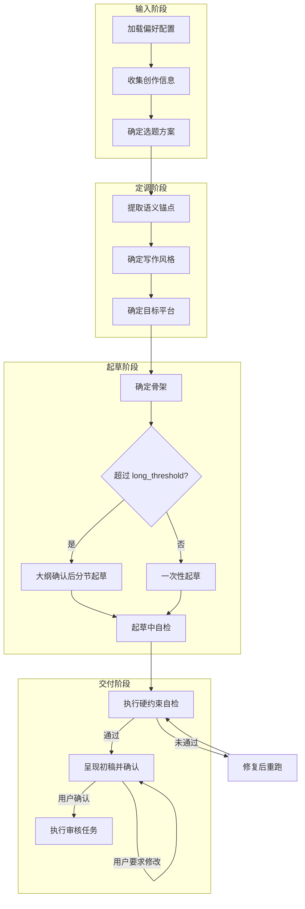

# 文章工作流

适用于完整文章创作。

## 流程总览



## 文件输出规则

| 条件 | 行为 |
|------|------|
| 未配置 `output_dir` | 仅在对话中输出，不保存文件 |
| 已配置 `output_dir` | 第七步生成草稿后，将草稿文件保存至 resolver 返回的 `output_dir`，文件名为 `{title}-draft.md`（必须带 `-draft` 后缀） |
| 文章通过审核正式交付时 | 重命名为 `{title}.md`（去掉 `-draft` 后缀） |

---

## 输入阶段

### 步骤1：加载偏好配置

调用 resolver 获取最小 active profile 配置：

```bash
python3 skills/human-media-writer/scripts/resolve_preferences.py \
  --workspace-dir "{workspace_dir}" \
  [--profile "<name>"]
```

### 步骤2：收集创作信息

明确以下内容：

- 发布平台
- 目标读者
- 主题
- 期望立场
- 可用素材
- 发布目标
- 禁止的主张或敏感边界

如果关键信息缺失，向用户提出问题进行澄清。

### 步骤3：确定选题方案（不可跳过）

将选题任务委派给 `references/subagents/agents/topic-selection.md` 子代理完成。

#### 交互规则

- MUST 将选题结果原样呈现给用户，不得精简，展示后等待选定。
- Never 在用户选定前输出正文大纲或起草正文。
- 用户选定后注入后续步骤：

| 选题字段 | 注入目标 |
|----------|----------|
| 目标用户与场景 | 补充步骤2的目标读者 |
| 内容结构 | 步骤7.1 叙事路径的主输入 |
| 核心论点 | 步骤7.1 的论点句；全文推进与回扣的锚点 |
| 关键词与标签 | 步骤7.3 标题与 SEO 用词 |

---

## 定调阶段

### 步骤4：提取语义锚点

从素材中提取以下信息，标记为不可改变的锚点：

- 名称、人名、机构名、产品名
- 日期、时间线和事件顺序
- 数字、价格、比例、排名
- 因果主张
- 对比关系
- 引述性陈述
- 否定、限制条件和极性（正面/负面立场）
- 不确定性标记（"可能"、"据说"、"目前来看"）
- 用户提供的个人经历
- 明确的情感倾向和价值判断

**约束**：若某主张缺乏支撑，标记为弱论据，以匹配的不确定性语气写作或省略。Never 为增强真人感而补造证据。

### 步骤5：确定写作风格

按以下优先级（高→低）确定风格：

1. 用户本次请求中的显式风格指令
2. resolver 返回的 `custom_style`（用户在 profile 中自行定义的完整风格参数）
3. resolver 返回的 `writing_style`（系统预设风格名，如 `conversational`、`analytical`）
4. `default` 风格预设

使用 resolver 返回的 `style` 获取具体声音参数（措辞习惯、节奏偏好、情感范围、开头方式、结尾偏好）。若用户提供写作样本要求模仿，按 SKILL.md §写作风格系统 的自定义风格结构与样本提取流程执行。

### 步骤6：确定目标平台

从用户信号确定平台：

| 信号 | 平台 |
|------|------|
| 公众号/微信/长文/深度 | 微信 |
| 小红书/xhs/笔记/种草 | 小红书 |
| 无信号 | resolver 返回的 active profile `platform`，再无则默认微信 |

确定后按 SKILL.md §平台形态 应用对应约束（段落长度上限、开篇模式、内容密度要求、读者注意力模型）。

---

## 起草阶段

### 步骤7：起草正文

起草的固定工序：**先定骨架 → 再填内容 → 边写边自检**

#### 7.1 起草前：确定骨架（不可跳过）

在写正文之前，内部确定三件事（不必向用户展开，除非进入长文大纲确认）：

1. **论点句**：从选题「核心论点」压成一句可辩护主张（不是主题词）。
2. **叙事路径**：用一句话描述文章的推进方式——从什么状态出发、经过什么转折、到达什么落点。不要列功能角色清单；路径应由内容本身的逻辑关系决定。
3. **首尾呼应**：确定一个能在结尾再次出现的线索（物件、场景、数字或问题）。结尾再次提到这条线索时，必须在开头的基础上增加新的判断、限制、行动建议或更具体的问题；Never 只是换一种说法重复开头。

#### 7.2 长文分支

以预估成稿是否超过 `long_threshold`（默认 3000 字符，以 active profile 为准）分支：

| 条件 | 行为 |
|------|------|
| 不超过 | 按 7.1 骨架一次性起草（7.3） |
| 超过 | 先把叙事路径展开为分节大纲（每节：一句话意图 + 计划用的具体材料），向用户确认结构后再分节起草；Never 长文一口气写完再补结构 |

长文分节时，每完成一节按 `rewrite-workflow.md` §6「跨节一致性检查」执行。

#### 7.3 写作

按 7.1 的叙事路径推进。每完成一段，内部确认一件事：
- 这一段给读者增加了什么他之前不知道的（事实、机制、对比、限制、步骤）。如果答不出，合并或删掉。

**开头**：使用风格 `preferred_opening`（scene / contradiction / data / confession / problem）+ 平台硬约束（微信：前 3 句建立冲突/场景/承诺；小红书：具体痛点或前后对比，1–3 句）。
**结尾**：使用风格 `ending_style`。
**质感**（句级，非段落级；在自然位置嵌入，不要当清单逐项塞入）：实操细节、现实质疑、不确定性承认、冷幽默（若风格允许）。

#### 7.6 起草中自检

MUST 全部通过后再进入步骤8，否则进行相应调整：

- [ ] **信息增量**：删掉任意一段后全文仍通顺且几乎不损信息 → 该段应删或合并。
- [ ] **首尾呼应**：结尾是否回应了开头的线索，并增加了新的判断、限制、行动建议或问题？如果只是换一种说法重复开头，则不通过。
- [ ] **论点回扣**：全文仍在捍卫 7.1 论点句，没有飘成相邻话题汇编。
- [ ] **具体支撑**：每个核心论点有至少一种具体材料；弱论据已降调。

---

## 交付阶段

### 步骤8：执行硬约束自检

正文完成后，MUST 调用约束检查脚本：

```bash
python3 skills/human-media-writer/scripts/check_article_constraints.py \
  --article "{article_path}" \
  --profile "{active_profile_name}" \
  --json
```

**修复规则**：

| 失败类型 | 修复策略 |
|----------|----------|
| `length` 未通过 | 一次性定位 1-3 处可精简段落，做集中删减（优先删冗余解释、重复论证、可合并段落）。Never 逐字微调，Never 为凑字数注水 |
| `words_to_avoid` 命中 | 逐词替换，用具体动作或事物替代包装性词汇 |

- 修复后重新运行脚本，确认通过后进入步骤9。
- 若连续3次修复仍未通过，向用户说明当前状态（实际字数、目标区间、难以进一步压缩的原因），请用户决定是否放宽约束。

### 步骤9：呈现初稿并确认

向用户呈现：

1. **完整文章初稿**（或指明已保存的文件路径）
2. **优化建议**（2-4 条）：基于当前稿件的可选改进方向，标记为建议，不自动执行

**交互规则**：
- 用户确认"可以/没问题/继续" → 进入步骤10
- 用户提出修改意见 → 执行修改后重新呈现，再次等待确认
- 用户采纳部分优化建议 → 执行对应建议后重新呈现

### 步骤10：执行审核任务

将审核任务委派给 `references/subagents/agents/article-review.md` 子代理完成。

结果处理与修复→再审循环按 `references/subagents/agents/article-review.md`「交互模式 · 主代理闭环」。

- 每轮全新独立任务，不复用选题或上一轮审核子代理。
- 只传当前待审核版本、目标平台、完整 AI 痕迹目录。
- 等待超时或调度错误不得同轮重派；结果用完后按规范关闭子代理。
