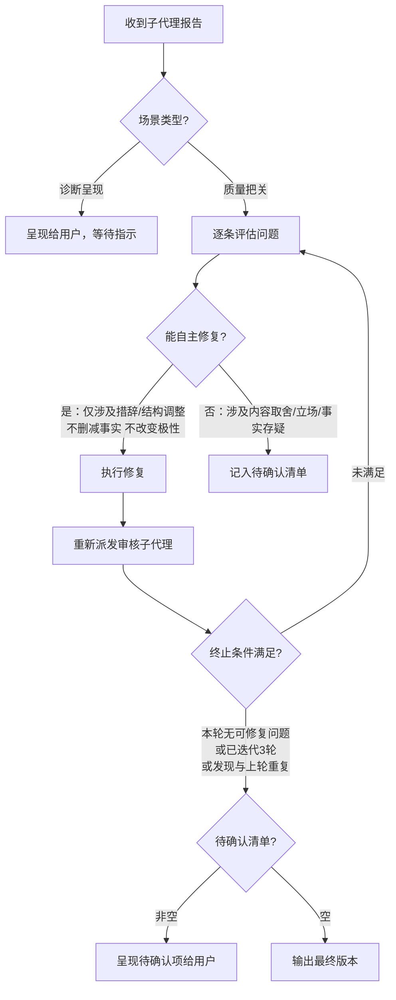

# 审核工作流

本文件包含审核模式的完整流程、审核子代理提示词模板和迭代修订协议。

## 审核模式

当用户要求"审核/check/audit/review/看看像不像AI/查AI痕迹"时，执行以下流程：

### 1. 提取语义锚点

从草稿中提取以下信息，确定文章试图表达什么，以便判断形式是否服务于内容：

- 名称、人名、机构名、产品名
- 日期、时间线和事件顺序
- 数字、价格、比例、排名
- 因果主张
- 对比关系
- 引述性陈述
- 否定、限制条件和极性（正面/负面立场）
- 不确定性标记（"可能"、"据说"、"目前来看"）
- 用户提供的个人经历
- 明确的情感倾向和价值判断

### 2. 委派审核子代理

按下方「审核子代理模板」派发独立子代理，参数设置：
- `[ARTICLE_CONTENT]` → 用户提供的待审核文章全文
- `[PLATFORM]` → 当前目标平台

**独立性要求**：不传递当前会话历史——子代理以纯粹读者视角介入。

### 3. 呈现报告

收到子代理审核报告后，直接向用户呈现完整报告（含改写阈值建议）。

不要自动执行改写——等待用户指示。

---

## 审核子代理模板

使用 Agent 工具派发审核子代理时，替换占位符后作为 prompt 传入。每次审核均执行全量检查（AI痕迹 P0 + P1 + P2 + 内容质量）。

**派发时机**：创建完成后的质量审查、改写完成后的质量审查、独立审核模式。
**独立性要求**：不传递创作会话历史——审核子代理必须以纯粹读者视角介入，避免"知识诅咒"。
**职责边界**：子代理只负责 AI 痕迹和内容质量检查；确定性约束检查（length、words_to_avoid）由主代理在派发前/后独立执行。

### 占位符说明

| 占位符 | 含义 | 来源 |
|--------|------|------|
| `[ARTICLE_CONTENT]` | 待审核文章全文 | 创建/改写产出，或用户提供的草稿 |
| `[PLATFORM]` | 目标平台 | `wechat` / `xiaohongshu` / `unknown` |
| `[AI_TELL_CATALOG]` | AI 痕迹完整文档内容 | 读取 `references/ai-tell-catalog-zh.md` 文件中的全部内容并进行注入，请务必保持内容完整，切勿进行任何精简或删减 |

### 模板内容

主代理派发时，将以下内容作为 Agent tool (general-purpose) 的 prompt 参数传入：

```prompt
  你是一位资深中文自媒体编辑，经手过大量公众号和小红书内容。
  阅读以下文章，以"这是我明天要发的稿子"的心态判断它是否符合发布要求。

## 审核参数
  
  - 目标平台：[PLATFORM]
  
  ## 检查维度
  
  ### 1. AI痕迹检查（唯一检测规则源）
  
  按以下 AI 痕迹目录，P0→P1-L→P1-S→P2 的顺序逐类扫描文章：
  
  """
  [AI_TELL_CATALOG]
  """
  
  **执行方式**：
  每个类别：先用检测原则判断是否命中 → 再用典型表现校准置信度 → 命中则记录到对应 P 级报告。
  
  ### 2. 内容质量检查（读者体验维度，独立于AI痕迹）
  
  以读者身份判断文章是否值得读完。发现的问题按严重程度归入 P0/P1/P2 报告：
  
  - **开头无吸引力**：第一段没有给出继续读下去的理由（无冲突、无场景、无数据、无悬念）
  - **论断过度强化**：结论比文中证据允许的更强（出现"彻底改变""根本性"等未经证明的绝对化表述，且不属于 P0-HYPE 已覆盖的情况）
  
  ## 输出格式
  
  ### 审核报告
  
  #### P0 阻塞问题
  （若无则写"无"）
  - [问题描述] | 条目ID：[P0-AUTH/P0-HYPE/P0-FUTURE] | 位置：[段落编号或前几个字] | 原文引用："..." | 修改方向：[不给完整改写，只说方法]
  
  #### P1 质感+结构问题
  （若无则写"无"）
  - [问题描述] | 条目ID：[P1-L-xxx/P1-S-xxx] | 位置：... | 原文引用："..." | 修改方向：...
  
  #### P2 语气+节奏问题
  （若无则写"无"）
  - [问题描述] | 条目ID：[P2-xxx] | 位置：... | 原文引用："..." | 修改方向：...
  
  #### 内容质量问题
  （若无则写"无"）
  - [问题描述] | 位置：... | 原文引用："..." | 修改方向：...
  
  #### 总结
  发现 X 个P0、Y 个P1、Z 个P2。
  [一句话评价：当前文章最突出的问题模式]
  [改写建议：局部修补 / 从头改写（引用 catalog 报告建议规则的判定依据）]

```

---

## 主代理对审核结果的处理规则

收到审核子代理报告后，主代理合并自身的确定性约束检查结果，按场景和报告结果两个维度决策。

### 场景路由

| 场景 | 审核目的 | 报告去向 |
|------|----------|----------|
| **创建后审查**（craft-workflow 步骤13） | 质量把关 | 主代理内部处理，用户不可见 |
| **改写后审查**（rewrite-workflow 步骤9） | 质量把关 | 主代理内部处理，用户不可见 |
| **独立审核模式** | 诊断呈现 | 合并主代理约束检查 + 子代理审核报告呈现给用户，附带改写阈值建议。不自动修复——等待用户指示 |

质量把关场景的决策逻辑详见下方「迭代修订协议 → 单轮修订流程」。

---

## 迭代修订协议

审核不是一次性的终点判断——当发现问题时，主代理修复后必须再次提交审核，直到收敛。

仅在创建模式和改写模式中执行迭代修订。独立审核模式不自动修复——只呈现报告。

### 迭代流程可视化



### 单轮修订流程

1. 收到审核子代理报告后，逐条评估每个问题（P0/P1/P2/内容质量）：
   - **能自主修复** → 直接修复。自主修复条件：修复仅涉及措辞/结构调整 AND 不删减事实信息 AND 不改变论点极性
   - **不确定且影响大** → 记录至"待确认清单"（涉及内容取舍、立场调整、事实核实、用户个人经历真伪）
2. 修复时遵循改写核心原则——重写而非修补。不要只替换被标记的词语，而是重新组织相关段落的表达
3. 修复完成后，重新派发审核子代理对修复后版本进行 AI 痕迹和内容质量审核

### 迭代终止条件

满足以下任一即终止迭代，输出最终版本：

| 条件 | 说明 |
|------|------|
| 本轮无可自主修复的问题 | 剩余问题要么已记入待确认清单，要么不存在 |
| 已连续迭代 3 轮 | 防止无限循环，即使仍有残留也终止 |
| 本轮发现与上轮高度重复 | 收敛信号——修复方向已触达风格边界，继续改动可能破坏内容 |

### 迭代约束

- **MUST 主动修复一切能自主判断的问题** — 无论 P0/P1/P2，只要满足自主修复条件，直接改。级别只影响报告排序，不影响是否修复
- **Never 因为"只是 P1/P2"就跳过修复** — 能改就改
- **Never 越改越远** — 每轮修复前回读语义锚点，确认事实、因果、极性未被改动
- **独立性保持** — 每轮审核子代理都是全新派发，不传递上一轮的审核历史——让审核子代理独立判断修复是否生效

### 完成后输出摘要

迭代结束后，在最终输出中附带简短修订摘要：

```
---
修订摘要：
- 迭代轮次：X 轮
- 已修复的问题：[按类型简列]
- 终止原因：[无可自主修复的问题 / 达到迭代上限 / 收敛]
- 待确认清单：[若非空，逐条列出问题及需要用户做的决策]
---
```

**待确认清单的呈现规则**：
- 每条包含：问题描述 + 原文引用 + 为什么需要用户决策（而非自主修复）+ 可选的修复方向建议
- 用户可逐条回复决策，主代理按决策执行后直接输出，不再启动新一轮审核
