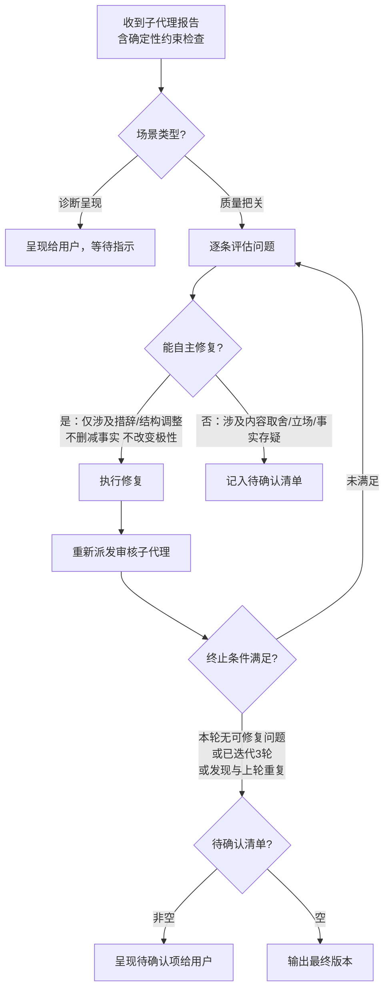

# 审核工作流

本文件包含审核模式的完整流程、审核子代理提示词模板和迭代修订协议。

## 审核模式

当用户要求"审核/check/audit/review/看看像不像AI/查AI痕迹"时，执行以下流程：

### 1. 提取语义锚点

从草稿中提取以下信息，确定文章试图表达什么，以便判断形式是否服务于内容：

- 名称、人名、机构名、产品名
- 日期、时间线和事件顺序
- 数字、价格、比例、排名
- 因果主张
- 对比关系
- 引述性陈述
- 否定、限制条件和极性（正面/负面立场）
- 不确定性标记（"可能"、"据说"、"目前来看"）
- 用户提供的个人经历
- 明确的情感倾向和价值判断

### 2. 准备确定性约束参数

审核中有一类问题不应交给模型凭感觉判断：`length` 是否落在目标区间、`words_to_avoid` / `avoid_words` 是否仍出现在正文中。这些来自 EXTEND.md、active 账号配置、custom_style 或风格预设的硬性约束，先用脚本检查，再判断人味、结构和内容质量。

### 3. 委派审核子代理

按下方「审核子代理模板」派发独立子代理，参数设置：
- `[ARTICLE_CONTENT]` → 用户提供的待审核文章全文
- `[PLATFORM]` → 当前目标平台
- `[CONSTRAINT_CHECK_ARGS]` → 除文章内容以外的脚本参数，例如 `--extend /path/to/EXTEND.md --profile wechat-tech --length "800-1200"`

**独立性要求**：不传递当前会话历史——子代理以纯粹读者视角介入。

### 4. 呈现报告

收到子代理审核报告后，直接向用户呈现完整报告，并附上确定性约束检查结果（含改写阈值建议）。

不要自动执行改写——等待用户指示。

---

## 审核子代理模板

使用 Agent 工具派发审核子代理时，替换占位符后作为 prompt 传入。每次审核均执行全量检查（P0 + P1 + P2 + 补充审查 + 改写阈值）。

**派发时机**：创建完成后的质量审查、改写完成后的质量审查、独立审核模式。
**独立性要求**：不传递创作会话历史——审核子代理必须以纯粹读者视角介入，避免"知识诅咒"。

### 占位符说明

| 占位符 | 含义 | 来源 |
|--------|------|------|
| `[ARTICLE_CONTENT]` | 待审核文章全文 | 创建/改写产出，或用户提供的草稿 |
| `[PLATFORM]` | 目标平台 | `wechat` / `xiaohongshu` / `unknown` |
| `[AI_TELL_CATALOG]` | AI 痕迹完整文档内容 | 读取 `references/ai-tell-catalog-zh.md` 文件中的全部内容并进行注入，请务必保持内容完整，切勿进行任何精简或删减 |
| `[CONSTRAINT_CHECK_ARGS]` | 确定性约束检查参数 | 主代理根据 EXTEND.md、active 账号配置、显式长度和显式风格生成；不包含文章内容本身 |

### 模板内容

主代理派发时，将以下内容作为 Agent tool (general-purpose) 的 prompt 参数传入：

```prompt
  你是一位资深中文自媒体编辑，经手过大量公众号和小红书内容。
  阅读以下文章，以"这是我明天要发的稿子"的心态判断它是否符合发布要求。
  
  ## 文章内容
  
  """
  [ARTICLE_CONTENT]
  """
  
  ## 审核参数
  
  - 目标平台：[PLATFORM]
  
  ## 确定性约束检查
  
  在开始 P 级检查前，先调用脚本检查硬约束：
  
  """bash
  python skills/human-media-writer/scripts/check_article_constraints.py \
    --text "[ARTICLE_CONTENT]" \
    [CONSTRAINT_CHECK_ARGS] \
    --json
  """
  
  将脚本输出纳入最终报告。`length` 失败、`words_to_avoid` / `avoid_words` 命中属于硬约束问题，不要改成主观判断。
  
  ## 检查维度
  
  ### P 级检查（按优先级）
  
  #### P0 — 必须修复（信任破坏）
  
  - **虚构或模糊的权威背书**：出现"专家表示""业内人士指出""相关研究表明"等无具名来源的归因
  - **重要性夸大**：出现"里程碑式/划时代/革命性/开创性/奠定坚实基础/谱写新篇章"等与实际内容不匹配的拔高
  - **挑战与未来公式**：以"机遇与挑战并存""未来可期""值得期待"等空泛展望收尾
  
  #### P1 — 语言质感 + 结构
  
  - **企业式AI词汇簇**：同一段落出现 ≥3 个"赋能/助力/深耕/布局/生态/维度/底层逻辑/闭环/抓手"
  - **四字词堆砌**：连续 3 个以上四字词构成排比或并列，读起来像公文
  - **翻译腔句法骨架**：含深层信号——被动前置、过长定语从句式修饰、"对于...而言"句式泛滥、主语省略导致歧义
  - **词的窄效应**：全文核心动词种类 < 8（同一个动词反复出现，如"实现""推动""提升"）
  - **模板化段落**：段落可互换顺序而不影响全文逻辑推进
  - **总分总结构**：开头提纲、中间逐条展开、结尾总结重申——教科书式而非对话式
  - **事件感缺失**：连续 800 字无一处具体事件叙事（有时间、地点、人物、动作的场景）
  - **反问句脚手架**：用设问/反问作为段落起点，仅服务于结构而非论证
  
  #### P2 — 语气与节奏
  
  - **完美中立**：全文无一处个人判断、立场或情感倾向——像百科词条而非自媒体
  - **强行金句**：结尾突然出现与正文脱节的格言式总结
  - **认知过度完美**：所有观点都"辩证"且"全面"，没有偏好、犹豫或承认不知道
  - **社交诱饵式结尾**："值得收藏""建议转发""看完你就懂了"等泛化引导
  - **节奏过匀**：连续 3 段以上相同句式结构；段落平均长度方差极低（几乎等长）
  
  ### 补充审查
  
  以下两类检查独立于 P 级体系，作为基础扫描。发现的问题按严重程度归入 P0/P1/P2 报告。
  
  #### AI味审查
  
  参考以下 AI 痕迹清单，逐项对照文章内容进行扫描：
  
  """
  [AI_TELL_CATALOG]
  """
  
  **执行方式**：
  1. 先完成上方 P 级检查的快速扫描（基于摘要规则）
  2. 再对照完整清单逐类复查，捕捉摘要规则未覆盖的细粒度信号
  3. 新发现的问题归入对应的 P0/P1/P2 级别报告
  
  #### 内容质量检查
  
  以读者身份判断文章是否值得读完：
  
  - **开头无吸引力**：第一段没有给出继续读下去的理由（无冲突、无场景、无数据、无悬念）
  - **段落无增量**：存在可互换顺序而不影响逻辑的段落——说明它没有推进论证
  - **缺乏人类细节**：全文无具体数字、人名、日期、感官事实或真实案例
  - **论断过度强化**：结论比文中证据允许的更强（出现"彻底改变""根本性"等未经证明的绝对化表述）
  - **结尾空洞**：落在口号或泛化展望上，而非具体想法、行动或精确问题
  
  ## 输出格式
  
  ### 审核报告
  
  #### P0 阻塞问题
  （若无则写"无"）
  - [问题描述] | 位置：[段落编号或前几个字] | 原文引用："..." | 修改方向：[不给完整改写，只说方法]
  
  #### 确定性约束检查
  （直接概括脚本结果）
  - length：[通过/未通过/跳过] | 实际字数：[visible_char_count] | 目标：[target/min-max]
  - words_to_avoid/avoid_words：[通过/未通过] | 命中：[逐项列出词、段落、引用；若无则写"无"]
  
  #### P1 质感问题
  （若无则写"无"）
  - [问题描述] | 位置：... | 原文引用："..." | 修改方向：...
  
  #### P2 节奏问题
  （若无则写"无"）
  - [问题描述] | 位置：... | 原文引用："..." | 修改方向：...
  
  #### AI味审查问题
  （对照完整清单发现的补充问题；若上方 P0/P1/P2 已覆盖则写"已在上方覆盖"）
  - [问题描述] | 级别：[P0/P1/P2] | 位置：... | 原文引用："..." | 对应清单条目：[条目名] | 修改方向：...
  
  #### 内容质量问题
  （若无则写"无"）
  - [问题描述] | 位置：... | 原文引用："..." | 修改方向：...
  
  #### 总结
  发现 X 个P0、Y 个P1、Z 个P2。
  [一句话评价：当前文章最突出的问题模式]

```

---

## 主代理对审核结果的处理规则

收到包含确定性约束检查结果的审核子代理报告后，主代理按场景和报告结果两个维度决策。

### 场景路由

| 场景 | 审核目的 | 报告去向 |
|------|----------|----------|
| **创建后审查**（article-workflow 步骤10） | 质量把关 | 主代理内部处理，用户不可见 |
| **改写后审查**（rewrite-workflow 步骤5） | 质量把关 | 主代理内部处理，用户不可见 |
| **独立审核模式** | 诊断呈现 | 直接呈现子代理报告（含确定性约束检查），附带改写阈值建议。不自动修复——等待用户指示 |

质量把关场景的决策逻辑详见下方「迭代修订协议 → 单轮修订流程」。

---

## 迭代修订协议

审核不是一次性的终点判断——当发现问题时，主代理修复后必须再次提交审核，直到收敛。

仅在创建模式和改写模式中执行迭代修订。独立审核模式不自动修复——只呈现报告。

### 迭代流程可视化



### 单轮修订流程

1. 收到包含确定性约束检查结果的审核报告后，逐条评估每个问题（无论硬约束/P0/P1/P2）：
   - **硬约束失败** → 优先修复。包括目标长度超出区间、`words_to_avoid` / `avoid_words` 命中正文。修复后必须在下一轮审核中让子代理再次调用脚本确认通过。
   - **能自主修复** → 直接修复。自主修复条件：修复仅涉及措辞/结构调整 AND 不删减事实信息 AND 不改变论点极性
   - **不确定且影响大** → 记录至"待确认清单"（涉及内容取舍、立场调整、事实核实、用户个人经历真伪）
2. 修复时遵循改写核心原则——重写而非修补。不要只替换被标记的词语，而是重新组织相关段落的表达
3. 修复完成后，重新派发审核子代理；子代理先调用脚本检查硬约束，再对修复后版本进行审核

### 迭代终止条件

满足以下任一即终止迭代，输出最终版本：

| 条件 | 说明 |
|------|------|
| 本轮无可自主修复的问题 | 剩余问题要么已记入待确认清单，要么不存在 |
| 已连续迭代 3 轮 | 防止无限循环，即使仍有残留也终止 |
| 本轮发现与上轮高度重复 | 收敛信号——修复方向已触达风格边界，继续改动可能破坏内容 |

### 迭代约束

- **MUST 主动修复一切能自主判断的问题** — 无论 P0/P1/P2，只要满足自主修复条件，直接改。级别只影响报告排序，不影响是否修复
- **MUST 用脚本验证硬约束** — `length` 和规避词命中不能只靠肉眼或子代理判断；每轮修复后都要以脚本结果为准
- **Never 因为"只是 P1/P2"就跳过修复** — 能改就改
- **Never 擅自修改不确定的内容** — 涉及"这个数据对不对""这个立场要不要保留""这段要删还是改"等判断时，记录至待确认清单而非猜测。如果修复某个问题会导致段落失去原有的具体信息或判断力，放弃修复
- **Never 越改越远** — 每轮修复前回读语义锚点，确认事实、因果、极性未被改动
- **独立性保持** — 每轮审核子代理都是全新派发，不传递上一轮的审核历史——让审核子代理独立判断修复是否生效

### 完成后输出摘要

迭代结束后，在最终输出中附带简短修订摘要：

```
---
修订摘要：
- 迭代轮次：X 轮
- 已修复的问题：[按类型简列]
- 硬约束检查：[通过 / 未通过，简述 length 与规避词结果]
- 终止原因：[无可自主修复的问题 / 达到迭代上限 / 收敛]
- 待确认清单：[若非空，逐条列出问题及需要用户做的决策]
---
```

**待确认清单的呈现规则**：
- 每条包含：问题描述 + 原文引用 + 为什么需要用户决策（而非自主修复）+ 可选的修复方向建议
- 用户可逐条回复决策，主代理按决策执行后直接输出，不再启动新一轮审核
