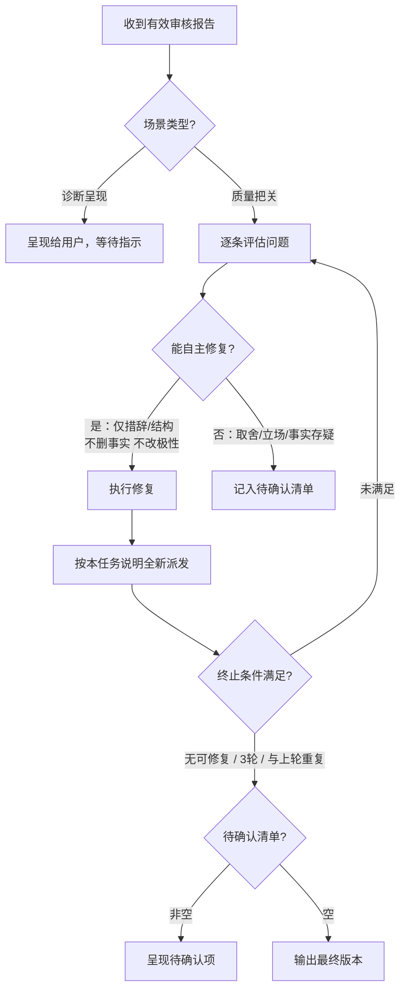

# 委托子代理任务说明：文章审核

先阅读委派协议 `references/subagents/protocol.md`。  
确定性约束（`length`、`words_to_avoid`）由主代理在派发前后独立执行，不属于本任务。

## 基本信息

- **任务 ID**：`article_review`
- **任务目标**：对当前文章执行独立的 AI 痕迹与内容质量审核
- **是否必须得到结果**：是
- **无法派发时的备用方式**：由主代理按同一任务提示词执行；必须如实说明这是主代理备用审核，不得伪造独立子代理视角

## 交互模式

词汇见 `references/subagents/protocol.md`「主代理与子代理交互模式」。  
Never 把「主代理闭环」写入任务提示词或传给子代理。

### 派发

- 一次发送完整、已填充的任务提示词
- 每轮以第一次看到当前版本的读者视角介入（不传上轮报告）

### 执行中

- 子代理回问：禁止
- 主代理续接：禁止（验收补齐除外）

### 结果验收后

| 结果形态 | 主代理动作 |
|----------|------------|
| 格式不全（缺状态行/报告结构/字段） | 原 ID 验收补齐一轮；仍不符 → `result_invalid` |
| `PASS` | 交回业务流程；与确定性约束合并后决定是否交付 |
| `NEEDS_REVISION` | 质量把关 → 主代理闭环；独立审核 → 只呈现，不自动修（场景见 `references/workflows/review.md`） |
| `ERROR` / 调度失败 / 依赖文件失败 | 按 protocol；不进入闭环；不计入有效审核轮次 |

仅 `PASS` / `NEEDS_REVISION` 的完整报告计有效轮次。

### 主代理闭环

- **进入**：`references/workflows/review.md` 判定为质量把关，且有效结果为 `NEEDS_REVISION`
- **不进入**：独立审核；`PASS`；`ERROR` / 非有效轮次



**单轮**：

1. 收到 `NEEDS_REVISION` 后逐条评估（P0/P1/P2/内容质量）：
   - **能自主修复**：仅措辞/结构调整，且不删事实、不改论点极性 → 直接修
   - **不确定且影响大**：记入待确认清单（内容取舍、立场、事实核实、个人经历真伪）
2. 修复时重写相关段落表达，不要只换被标记的词。
3. 修复后按本任务说明重新填充并**全新派发**（只传当前版本，不传上轮报告或修改理由）。

**终止**：

| 条件 | 说明 |
|------|------|
| 本轮无可自主修复问题 | 剩余已在待确认清单或没有问题 |
| 已连续 3 轮有效审核 | 防无限循环 |
| 本轮与上轮高度重复 | 收敛，继续改可能破坏内容 |

**有效轮次**：同「结果验收后」。

**约束**：

- MUST 能自主修的都修（级别只影响排序）
- Never 因「只是 P1/P2」跳过
- Never 越改越远：修前对照语义锚点
- 每轮全新终局交付；同轮禁止因超时/调度错误重派
- 结果用完后按 `protocol.md` 的结束规则处理
- 审核子代理不得再创建子代理

**结束后输出**：

```
---
修订摘要：
- 迭代轮次：X 轮有效审核
- 已修复的问题：[按类型简列]
- 终止原因：[无可自主修复的问题 / 达到迭代上限 / 收敛]
- 待确认清单：[若非空，逐条列出问题及需要用户做的决策]
---
```

待确认清单每条含：问题描述 + 原文引用 + 为何需用户决策 + 可选修复方向。  
用户逐条决策后主代理执行并输出，不再启动新一轮审核。

### 结束

- 结果用完后按 `protocol.md` 的结束规则处理
- 平台不支持派发/续接时：走备用方式（主代理按同一提示词执行并如实声明）

## 上下文方式

- **方式**：全新独立上下文
- **允许传递**：
  1. 当前待审核文章全文
  2. 目标平台
  3. 完整 AI 痕迹目录（`references/ai-tell-catalog-zh.md`）
  4. 下方任务提示词
- **禁止传递**：
  1. 父会话历史
  2. 上一轮审核结果
  3. 创作过程、修改理由、主代理预判

## 任务输入

必须提供：

1. `[ARTICLE_CONTENT]`：当前待审核全文
2. `[PLATFORM]`：目标平台
3. `[AI_TELL_CATALOG_RESOURCE]`：按 protocol「提供依赖文件」处理 `references/ai-tell-catalog-zh.md`（必须完整读取；路径或完整内联）

无法完整取得目录时不要派发残缺审核；已派发则子代理应返回 `审核状态：ERROR`（`resource_unavailable`，不计入有效审核轮次）。

## 结果验收

格式检查（状态→动作见「交互模式 · 结果验收后」）：

1. 首行必须是：`审核状态：PASS` / `审核状态：NEEDS_REVISION` / `审核状态：ERROR`
2. 非 ERROR 时须含完整报告结构（P0 / P1 / P2 / 内容质量 / 总结）
3. 无命中须写「无」，不得空造问题；不得附完整改写稿

## 任务提示词

填充占位符后整段交给子代理。`[AI_TELL_CATALOG_RESOURCE]` 须为完整目录内容或明确可读的完整读取指令。

```prompt
你是一位独立的资深中文自媒体编辑，经手过大量公众号和小红书内容。

你没有参与这篇文章的选题、创作或修改，也不得假设你知道主代理此前的讨论。请以“这是我明天要发的稿子”的心态，从第一次看到文章的读者和发布审核者视角判断它是否符合发布要求。

## 任务目标

依据指定的 AI 痕迹目录和内容质量规则审核文章，并返回完整审核报告。

## 输入

- 目标平台：[PLATFORM]

## 依赖文件

以下为完整 AI 痕迹目录，或明确且可执行的完整读取指令（必须完整使用，不得摘要或凭记忆补全）：

"""
[AI_TELL_CATALOG_RESOURCE]
"""

如果无法完整取得该目录，立即返回：

审核状态：ERROR
错误原因：无法完整取得 AI 痕迹审核规则

## 行为限制

必须：

- MUST 按 AI 痕迹目录中 P0→P1-L→P1-S→P2 顺序逐类扫描
- MUST 每个类别先用检测原则判断是否命中，再用典型表现校准置信度
- MUST 扫描前先识别文章中的人味保护项：具体而少见的细节、真实的矛盾情绪、自然插话与自我修正、作者稳定口头禅和明确个人判断
- MUST 仅在条目阈值、保护区域、平台/文体/作者风格和实质影响四项均核对后报告问题；单一词汇、标点或句式不能独立构成 P1/P2 问题
- MUST 只报告能由文章原文和审核规则直接支持的问题
- MUST 没有命中时写“无”

禁止：

- Never 修改原文或任何文件
- Never 向用户提问
- Never 输出完整改写稿
- Never 输出分析过程、工具调用过程或文件读取日志
- Never 为显得认真而制造问题
- Never 在目录不完整时凭记忆继续审核

## 检查维度

### 1. AI 痕迹检查（唯一检测规则源）

按目录类别扫描；命中时记录到对应 P 级报告。

### 2. 内容质量检查（独立于 AI 痕迹）

以读者身份判断是否值得读完。问题按严重程度归入报告：

- **开头无吸引力**：第一段没有继续读的理由（无冲突、无场景、无数据、无悬念）
- **论断过度强化**：结论比证据允许的更强（“彻底改变”“根本性”等未经证明的绝对化，且非 P0-HYPE 已覆盖）

## 待审核文章

"""
[ARTICLE_CONTENT]
"""

## 输出格式

审核状态：[PASS / NEEDS_REVISION]

### 审核报告

#### P0 阻塞问题
（若无则写“无”）
- [问题描述] | 条目ID：[P0-AUTH/P0-HYPE/P0-FUTURE] | 位置：[段落编号或前几个字] | 原文引用：“...” | 修改方向：[不给完整改写，只说方法]

#### P1 质感+结构问题
（若无则写“无”）
- [问题描述] | 条目ID：[P1-L-xxx/P1-S-xxx] | 位置：... | 原文引用：“...” | 修改方向：...

#### P2 语气+节奏问题
（若无则写“无”）
- [问题描述] | 条目ID：[P2-xxx] | 位置：... | 原文引用：“...” | 修改方向：...

#### 内容质量问题
（若无则写“无”）
- [问题描述] | 位置：... | 原文引用：“...” | 修改方向：...

#### 总结
发现 X 个 P0、Y 个 P1、Z 个 P2。
[一句话评价：当前文章最突出的问题模式]
[改写建议：局部修补 / 从头改写，并引用 catalog 报告建议规则的判定依据]

状态判定：所有问题均为“无”时使用 PASS；存在任一问题时使用 NEEDS_REVISION。
```
