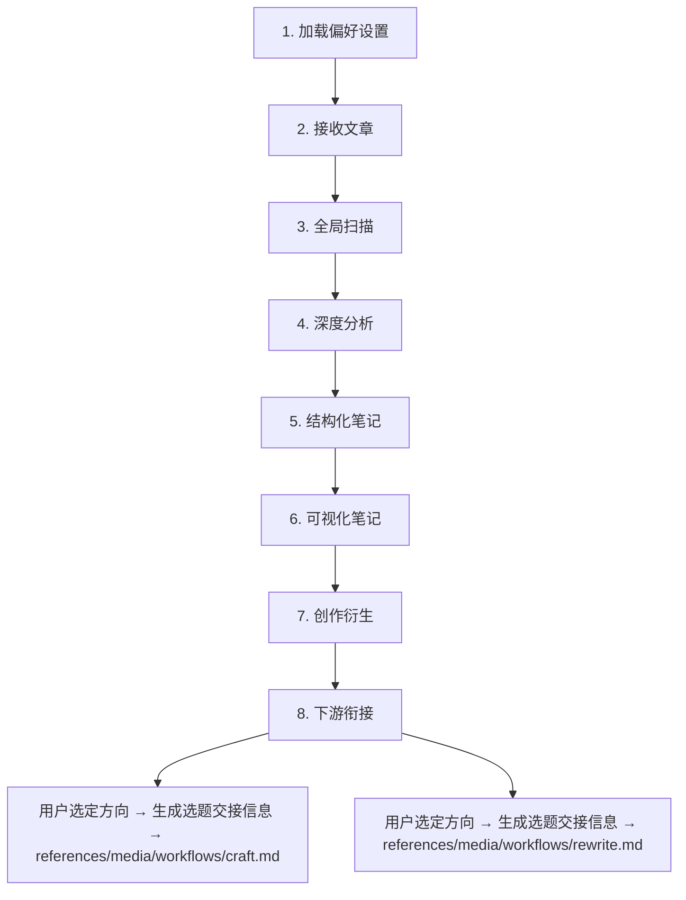

# 分析工作流

当用户提供一篇现有文章并要求分析、拆解或获取创作灵感时，使用本文件执行分析模式。

分析模式从一篇文章中提取可立即执行的行动和可创作方向，产出有证据支撑的行动清单与选题优先级表。

分析报告不算成稿。报告里的 emoji、字段冒号、表格和 Mermaid 图照原样保留，不跑 `check_prose.py`。但报告中所有会进入写作的文字，也就是创作衍生的"方向"标题、选题推荐的"选题方向"，以及「选题交接信息」的标题、核心论点和切入策略，要遵守 SKILL.md「成稿绝对不能出现」。核心论点写成正面判断加依据，不用"大家以为……其实……""不是……而是……"这类翻案句式，否则翻案句会顺着交接信息进入正文。

## 整体流程概览



## 输出控制规则

每个步骤定义了固定输出格式。执行时遵循以下规则：

| 规则 | 说明 |
|------|------|
| **条件输出** | 步骤 5 的三个模块、步骤 6 的可视化、步骤 7.1-7.4 的四个维度，仅在该模块能产出超越原文表面的增量信息时才输出；无增量价值的模块跳过并注明"本文不适用" |
| **不可跳过** | 步骤 3（全局扫描）、步骤 4（深度分析）、步骤 7.5（选题优先级）为必输出步骤 |
| **最少数量** | 标注"N-M 个"的字段表示输出区间；低于下限说明文章在该维度信息不足，需显式注明 |

## 1. 加载偏好设置

调用 resolver 获取最小 active profile 配置：

```bash
python3 scripts/resolve_preferences.py \
  --workspace-dir "{workspace_dir}" \
  [--profile "<name>"]
```

resolver 内部优先读取项目级 `{workspace_dir}/.human-rewriter/EXTEND.md`，再读取用户级 `$HOME/.human-rewriter/EXTEND.md`。只使用脚本返回的 active profile；不要直接读取完整 EXTEND.md。

active profile 中的 `positioning`、`audience`、`purpose` 用于校准步骤 7 创作衍生方向的匹配度——确保推荐的选题与创作者的账号定位一致。

## 2. 接收文章

确认文章输入方式并获取全文：

| 输入形式 | 操作 |
|----------|------|
| 用户直接粘贴全文 | 直接使用 |
| 用户提供 URL | 使用可用的网页抓取工具获取内容 |
| 用户提供文件路径 | read 文件 |

如果文章为非中文语言，分析以原文语言进行理解，但所有输出以中文产出。

## 3. 全局扫描

通读全文，形成整体判断。**按如下固定格式输出**：

```
## 文章分析报告

📊 综合推荐度：X/10 | 观点新颖度：X/10
📂 文章类型：[观点型 / 科普型 / 叙事型 / 分析型 / 教程型]
🎯 核心主旨：[一句话概括]
📌 值得深挖的方向：[2-3 个初步标记]
```

评分标准：
- 综合推荐度：1=信息陈旧且无独特视角，10=信息密度极高且有原创框架
- 观点新颖度：1=完全是已知共识，10=提出颠覆性视角且论证充分

## 4. 深度分析

逐段精读，提取以下信息。

### 4.1 关键要点（3-5 个）

文章最核心、最精炼的观点或结论。每条包含一句话提炼 + 支撑该观点的原文精华句作为证据锚点。

```
## 深度分析
#### 关键要点
1. **{一句话观点}**
   > 原文引用："{支撑该观点的原文引用}"
   > 证据功能：{支撑论点 / 核心数据 / 权威引述 / 反例}

2. **{一句话观点}**
   > 原文引用："{原文引用}"
   > 证据功能：{...}

3. ...
```

### 4.2 深层洞察（3-5 个）

超越文本表面的独到见解。每条必须包含：
- **原文锚点**：从哪个具体信息出发
- **推导逻辑**：结合什么背景知识
- **结论**：得出什么新认知

没有推导逻辑的条目不输出——那只是换了一种方式复述原文。

```
#### 深层洞察
1. - **原文锚点**：{原文中的具体信息}
   - **推导逻辑**：{结合的背景知识}
   - **结论**：{新认知}

2. ...
```

### 4.3 关键术语（2-5 个）

可能对理解构成障碍或值得深挖的专业概念，附一句话解释。

```
#### 关键术语
| 术语 | 解释 | 深挖价值 |
|------|------|----------|
| {术语} | {一句话解释} | {高/中/低：是否值得单独成文} |
```

### 4.4 核心问题问答（3 个）

设想读者读完最可能提出的 3 个疑问，用原文作答。三个问题默认分别对准读者最关心的事、文章的方法或前提假设、结论能不能用到读者自己身上。

回答只依据原文，引用或转述原文信息。原文答不上的疑问改放到别处，属于文章盲点的写进 5.2 批判性反思，属于文章提到却没展开的概念写进 7.2 知识缺口方向。

```
#### 核心问题问答
1. **问：** {读者最可能关心的问题}
   **答：** {基于原文的回答}
   > 原文依据："{支撑回答的原文引用}"

2. **问：** {关于文章方法或前提假设的问题}
   **答：** {基于原文的回答}
   > 原文依据："{原文引用}"

3. **问：** {关于结论能否应用的问题}
   **答：** {基于原文的回答}
   > 原文依据："{原文引用}"
```


## 5. 结构化拆解

**步骤 4 vs 5 分工契约：**
- **步骤 4 = 逐条提取（单点深度）**：从原文中独立抽取每个要点、洞察、术语、引用——每条自成一体，不依赖其他条目
- **步骤 5 = 跨条合成（关系与反思）**：以步骤 4 的编号为节点，揭示它们之间的推导关系、矛盾张力和适用边界——产出的是"关系"而非"新提取"

步骤 4 已产出的信息只引用编号，不重述。若某条内容无法明确归属，判断标准：能脱离其他条目独立成立→属于步骤 4；必须关联两个以上条目才有意义→属于步骤 5。

**条件输出格式**（逐模块判断）：

```
### 结构化拆解
```

### 5.1 论证逻辑链

以 4.1 的要点编号为节点，展示它们之间的推导关系。不重复提炼核心观点（4.1 已覆盖）。

> 跳过条件：文章为纯叙事/列举型，无明确论证结构时注明"本文无显著论证链"。

```
#### 论证逻辑链
| # | 起点 | 推导路径 | 终点 | 隐含前提/跳跃 |
|---|------|----------|------|----------------|
| 1 | {4.1-① 编号+简述} | → {中间环节} → | {4.1-③ 编号+简述} | {如有则标注，无则留空} |
| 2 | ... | ... | ... | ... |
```

### 5.2 批判性反思

对文章观点进行独立思考：潜在的局限性、适用边界、未讨论的反面。

> 跳过条件：文章论证严密且已自我限定适用范围时注明"未发现显著盲点"。

```
#### 批判性反思

1. **{局限/盲点标题}**：{具体分析} — 适用边界：{在什么条件下论点成立/失效}
2. ...
```

### 5.3 反思与行动（2-4 条）

从文章中提炼对读者（或创作者自身）可直接执行的反思和行动项。每条必须包含：
- **触发点**：文章中哪个观点/事实引发了这条反思（引用步骤 4 编号）
- **反思**：这对"我"意味着什么——认知上的冲击、确认或修正
- **行动**：可在短期内启动的具体行动事项（非泛泛的"多思考"）

Never 输出无法落地的空洞感悟（如"要保持开放心态"）——每条行动必须回答"明天具体做什么"。

> 跳过条件：文章为纯技术教程或操作指南型，不涉及认知/策略层面启发时注明"本文偏操作层，无显著反思价值"。

```
#### 反思与行动

1. - **触发点**：{步骤 4 编号 + 简述}
   - **反思**：{对我的认知/实践意味着什么}
   - **行动**：{具体可执行的行动项}

2. ...
```

## 6. 内容可视化

从文章中选择 1-3 个最值得可视化的维度，用 Mermaid 呈现。自行判断最合适的图表类型：

| 内容特征 | 推荐图表类型 |
|----------|-------------|
| 因果/流程/决策路径 | flowchart |
| 层级/归属/分类体系 | mindmap |
| 时间演进/阶段发展 | timeline |
| 对比/并列关系 | quadrantChart 或表格 |
| 文章整体逻辑骨架 | mindmap |

选型自由度：不限于上表，任何能降低理解成本的 Mermaid 图表类型均可使用。

```
#### 内容可视化
##### {图表标题}
{选型说明：一句话解释为什么选择此图表类型}

{Mermaid 代码块}
```

> 跳过条件：文章逻辑关系简单且结构平铺（如 2-3 段平行论述、纯列举型），可视化无法产出超越文字的增量理解时注明"本文无需额外可视化"。

## 7. 创作衍生

基于步骤 3-5 的分析成果，从四个维度激发创作方向。每个方向的"灵感来源"字段指向步骤 4-5 中的具体编号（如"洞察 4.2-③"、"逻辑链 5.1"）。

**条件输出格式**（7.1-7.4 逐维度判断，7.5 必须输出）：

```
### 创作衍生
```

### 7.1 观点衍生方向（1-3 个）

从深层洞察和核心论点中提取可独立成文的角度：

```
#### 观点衍生方向
- **方向 N：** [具体选题角度]
  - **灵感来源：** [步骤编号 + 具体内容引用]
  - **切入策略：** [与原文观点商榷 / 深化某个子论点 / 将观点迁移到新人群验证 / 用新案例重新论证]
  - **内容形式：** [深度长文 / 观点短评 / 案例拆解 / 对比分析]
```

> 跳过条件：文章观点全为已知共识，无可衍生角度时注明。

### 7.2 知识缺口方向（1-3 个）

从关键术语和论据数据中发现文章提到但未充分展开的概念——这些"留白"本身就是创作素材：

```
#### 知识缺口方向
- **方向 N：** [选题角度]
  - **知识缺口：** [文章提到但未展开的概念，或数据背后未讲述的故事]
  - **为什么值得写：** [对应什么读者需求]
  - **建议深度：** [科普入门 / 中度解析 / 专业深挖]
```

> 跳过条件：文章已充分展开所有概念，无明显留白时注明。

### 7.3 反面与补位方向（1-3 个）

从步骤 5.2 的批判性反思出发，寻找"补位型"创作机会：

```
#### 补位方向
- **方向 N：** [选题角度]
  - **补位逻辑：** [原文忽略了什么视角/人群/反例/前提条件]
  - **与原文的对话关系：** [补充 / 限定条件 / 提供反例 / 换立场重述]
  - **目标读者：** [谁会对这个"另一面"感兴趣]
```
> 跳过条件：步骤 5.2 未发现显著盲点时注明。

### 7.4 跨域迁移方向（1-3 个）

将核心观点迁移到完全不同的领域：

```
#### 跨域迁移方向
- **方向 N：** [跨域选题]
  - **原始观点：** [步骤编号 + 具体观点]
  - **迁移到：** [另一个领域/学科/行业/生活场景]
  - **迁移后的新发现：** [在新语境下揭示了什么/产生了什么矛盾/带来了什么启示]
```

> 跳过条件：文章观点强依赖特定领域语境，迁移后失去解释力时注明。

### 7.5 选题优先级（必须输出）

从 7.1-7.4 实际产出的方向中，综合评估后选出最值得优先创作的 3 个，并给出每个选题的第一步行动。

评估维度：时效性、受众规模、差异化程度、执行难度、与创作者定位的匹配度（以 EXTEND.md 的 positioning/audience/purpose 为校准锚点；无则基于文章受众特征推断）。

「建议下一步」写具体动作，比如先收集什么素材、采访谁、先写哪一部分。优先写清缺哪类材料、从哪里补，因为转入写作后，第一关会先清点材料够不够。

```
#### 选题推荐
| 优先级 | 选题方向 | 来源 | 推荐理由 | 建议下一步 |
|--------|----------|------|----------|------------|
| 1 | [最推荐的选题] | [7.N] | [核心理由] | [第一步行动] |
| 2 | [次推荐的选题] | [7.N] | [推荐理由] | [第一步行动] |
| 3 | [第三推荐的选题] | [7.N] | [推荐理由] | [第一步行动] |
```

## 8. 下游衔接

分析产出的“选题方向”是值得写什么的判断（有灵感来源、有切入策略），但还不是可直接执行的选题——它缺少精确的读者画像、核心论点句、内容结构预判和标题方案。

### 选题交接信息

只传递用户选中方向及其直接依据，不传递未选方向、完整分析会话或中间推理。按以下固定结构整理：

```text
选题交接信息

- 标题：用户选定方向的标题
- 核心论点：该方向准备证明的可辩护主张，写成正面判断
- 切入策略：从什么场景、矛盾、机制或读者问题进入
- 目标读者：最可能关心该问题的人及阅读场景
- 原文依据：
  1. 支撑该方向的原文信息或步骤编号
  2. ……
- 事实与表达边界：
  1. 不得改变的事实、因果、极性和限制条件
  2. ……
- 未决信息：当前仍缺失或不确定、需要降调处理的信息；无则写“无”
```

如果某字段没有可靠依据，填写“未提供”，不得推测或补造。

### 下游路由

| 用户意图 | 下游流程 | 交接方式 |
|----------|----------|----------|
| “按这个方向写一篇” / “就写方案 N” | `references/media/workflows/craft.md` | detail 流程将完整“选题交接信息”作为 `[CANDIDATE_TOPIC]`；simple 流程直接以交接信息的核心论点进入 craft 步骤4 |
| “按这个方向改写原文” / “用方案 N 改” | `references/media/workflows/rewrite.md` | detail 流程将完整“选题交接信息”作为 `[CANDIDATE_TOPIC]`；simple 流程直接以交接信息的核心论点进入 rewrite 步骤3。两种流程都保留原文语义锚点 |

进入下游流程后沿用当前 flow。detail 流程中，craft 步骤 3 和 rewrite 步骤 2 的选题任务不跳过，即使用户已经选了方向，因为分析方向是粗粒度创作灵感，下游选题任务负责评审并锐化为完整方案。simple 流程不再派选题子代理。创建流程仍要先过 craft 步骤2.5 的第一关材料检查，原文依据只算其中一部分材料。
