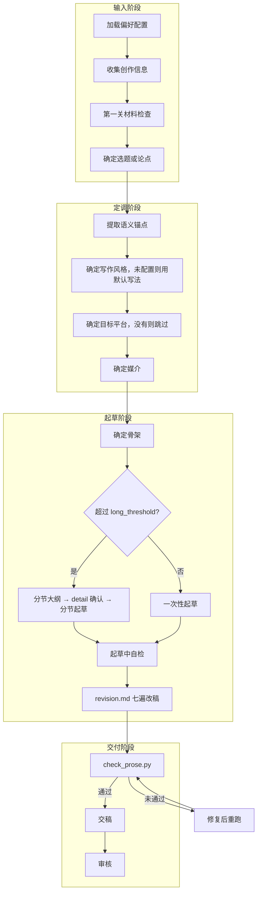

# 创建工作流

适用于所有从话题、笔记、转录稿或素材新写的任务。写作内核以 SKILL.md 为准，本文件只补账号、平台、风格、flow 与审核相关的步骤。没有账号配置、没有目标平台或没有配置风格时，对应步骤跳过。

## 流程总览



## 文件输出规则

| 条件 | 行为 |
|------|------|
| 未配置 `output_dir` | 仅在对话中输出，不保存文件 |
| 已配置 `output_dir` | 起草完成后，将文件保存至 resolver 返回的 `output_dir`，文件名为 `{title}.md`；有目标平台时，文件内容以 `# {platform}-{medium}-draft` 作为顶级标题标记草稿态，文章标题用二级标题 `## {title}` 紧跟其后；没有目标平台时只写 `# {title}` |
| 文章通过审核正式交付时 | 将分区标题中的 `-draft` 后缀去掉（如 `# xhs-note-draft` → `# xhs-note`）。simple 流程且合规清单为空时，check_prose.py 通过即视为交付 |

`# {platform}-{medium}` 分区标题是文件编排标记，不是正文，check_prose.py 不对它报错。

---

## 输入阶段

### 步骤1：加载偏好配置

存在 EXTEND.md 或带了 `--profile` 时，调用 resolver 获取最小 active profile 配置（路径以 human-rewriter 技能目录为根），否则跳过，合规清单按 `[]` 处理：

```bash
python3 scripts/resolve_preferences.py \
  --workspace-dir "{workspace_dir}" \
  [--profile "<name>"]
```

按 SKILL.md「交互流程 simple 与 detail」的决定顺序确定 flow。

### 步骤2：收集创作信息

明确以下内容：

- 文体，有发布平台时连同平台与媒介
- 目标读者
- 主题
- 期望立场
- 可用素材
- 发布目标
- 禁止的主张或敏感边界：读取 resolver 返回的 `compliance_guardrails`，与本次明确边界形成完整任务清单，按 `references/media/overview.md`「合规红线」处理冲突

关键信息缺失时，一次最多问 3 个问题。

### 步骤2.5：第一关材料检查（不可跳过）

按 SKILL.md「第一关先看作品靠什么站住」清点材料。这一步先于选题，因为选题子代理只能围绕已有材料出方案。

- 材料够，继续。
- 事实型题目能检索，先研究再重新计数。
- 依赖个人经历，一次最多问三件事。
- 用户不许追问、研究后仍然不足，缩小题目，把 `length` 视为上限而不是目标，交稿时说明实际字数。

`length` 与材料冲突时，材料优先。

### 步骤3：确定选题或论点

#### detail 流程：委派选题子代理

将选题任务委派给 `agents/topic-selection.md` 子代理完成。

- MUST 将选题结果原样呈现给用户，不得精简，展示后等待选定。
- Never 在用户选定前输出正文大纲或起草正文。
- 用户选定后注入后续步骤：

| 选题字段 | 注入目标 |
|----------|----------|
| 目标用户与场景 | 补充步骤2的目标读者 |
| 内容骨架 | 步骤7.1 叙事路径的主输入 |
| 核心论点 | 步骤7.1 的论点句 |
| 撑住论点的材料 | 核对步骤2.5 的材料清单，缺的项回到步骤2.5 |
| 关键词与标签 | 步骤7.3 标题与搜索用词 |

#### simple 流程：内部定论点

不派子代理。用户已经给了角度，直接用；没给时，主代理从步骤2.5 的材料里定一个能用材料证明的论点，不展示给用户，直接进入步骤4。

---

## 定调阶段

### 步骤4：提取语义锚点

按 `references/rework.md`「动手前记下不能改的东西」的清单，从素材中提取锚点。

**约束**：若某主张缺乏支撑，标记为弱论据，以匹配的不确定性语气写作或省略。Never 为增强真人感而补造证据。

### 步骤5：确定写作风格

按以下优先级（高→低）确定风格：

1. 用户本次请求中的显式风格指令
2. resolver 返回的 `custom_style`
3. resolver 返回的 `writing_style`（内置预设名：`lucid-tech`、`life-observer`、`sharp-commentary`、`warm-narrative`）
4. 都没有时不套用预设，按 SKILL.md 的默认写法写

有风格时使用 resolver 返回的 `style` 获取声音参数。用户提供写作样本要求模仿时，按 `references/media/voice.md`「从用户样本提取风格」执行。风格参数命中硬禁令时不执行（`references/media/overview.md` 关键规则#5）。

### 步骤6：确定目标平台

| 信号 | 平台 |
|------|------|
| 公众号/微信/长文/深度 | 微信 |
| 小红书/xhs/笔记/种草 | 小红书 |
| 无信号 | resolver 返回的 active profile `platform`，再无则没有目标平台，跳过步骤6.5 与所有平台形态约束，按文体写 |

### 步骤6.5：确定媒介

| 信号 | 媒介 |
|------|------|
| 长文/深度/专栏文章 | article（长图文） |
| 短图文/卡片/笔记/种草 | note（短图文笔记） |
| 无信号 | resolver 返回的 active profile `medium`，再无则按平台推断（微信→article，小红书→note） |

确定后从 `references/media/platforms/{platform}-{medium}.md` 加载完整形态约束。篇幅特性与 `length` 冲突时，以 `length` 为准；`length` 与材料冲突时，以步骤2.5 为准。

---

## 起草阶段

### 步骤7：起草正文

动笔前按 SKILL.md「按任务读取」的文体清单读取参考文件，比如散文长帖读 `references/forum-prose.md`，现实题材另读 `references/reality.md`，虚构改读 `references/fiction.md`。

#### 7.1 起草前：确定骨架（不可跳过）

在内部确定以下事项，不向用户展开，除非进入 detail 流程的长文大纲确认：

1. **论点句**：从选题「核心论点」或 simple 流程的内部论点压成一句可辩护的正面判断。
2. **叙事路径**：一句话描述文章从什么状态出发、经过什么变化、到达什么落点。路径由材料之间的因果决定，不列功能角色清单。
3. **结尾落点**：确定文章在哪里可以停。首尾呼应不是必做项，只有开头的物件、场景、数字或问题在正文里改变了作用或含义，结尾才让它回来（SKILL.md「第一稿直接带着人写」）。
4. **合规边界**：按当前 `compliance_guardrails` 逐条核对标题、论点、叙事路径、案例与行动建议；有冲突先处理，不把违规主张写入正文。

**媒介结构步（守卫式，可选）**：有目标平台时，读取 `references/media/platforms/{platform}-{medium}.md` §结构步。该节非空则按其说明补做这一步，并入骨架；为空则跳过。

#### 7.2 长文分支

以预估成稿是否超过 `long_threshold`（默认 3000 字符，以 active profile 为准）分支：

| 条件 | 行为 |
|------|------|
| 不超过 | 按 7.1 骨架一次性起草（7.3） |
| 超过，detail | 先把叙事路径展开为分节大纲（每节一句话意图 + 计划用的具体材料），与用户确认结构后分节起草 |
| 超过，simple | 在内部拟分节大纲，直接分节起草 |

长文分节时，每完成一节按 `references/media/workflows/rewrite.md`「长内容跨节一致性」执行。

#### 7.3 写作

按 7.1 的叙事路径推进。有目标平台时，把 `references/media/platforms/{platform}-{medium}.md` §起草侧重 叠加在 SKILL.md「第一稿直接带着人写」之上。形态侧重优先于通用倾向，但不越过硬禁令、第一关和 `length` 上限。

每完成一段，内部确认一件事：这一段给读者增加了什么他之前不知道的（事实、机制、对比、限制、步骤）。答不出，合并或删掉。

- **开头**：有风格时参考 `preferred_opening`（scene / contradiction / data / confession / problem），有平台时参考形态开篇钩子，都没有时按 SKILL.md「第一稿直接带着人写」。`contradiction` 是把两件对不上的事实摆在一起，不是先立误解再推翻。
- **结尾**：有风格时参考 `ending_style`，服从 7.1 的结尾落点。
- **质感**：实操细节、现实质疑、不确定性承认、冷幽默（若风格允许）在自然位置出现，不当清单逐项塞入。

#### 7.4 起草中自检

全部通过后再进入 7.5，否则调整：

- [ ] **信息增量**：删掉任意一段后全文仍通顺且几乎不损信息 → 该段应删或合并。
- [ ] **论点回扣**：全文仍在支撑 7.1 论点句，没有飘成相邻话题汇编。
- [ ] **具体支撑**：每个核心论点有至少一种具体材料；弱论据已降调。
- [ ] **结尾**：删掉最后一段是否更好；首尾呼应只在含义变化时出现。
- [ ] **合规红线**：逐条核对当前任务清单；无法确认或修复涉及事实取舍时，记录待确认项。

#### 7.5 改稿

按 `references/revision.md` 的七遍改稿处理草稿，由主代理自己完成，不另派子代理。执行时带上：

- 步骤4 的全部语义锚点，含义不得改变
- 步骤5 的风格声音参数、步骤6/6.5 的平台与媒介约束（有则带上）
- 当前完整 `compliance_guardrails`

平台格式所需的信息标签冒号（如小红书"📍地址："）按 SKILL.md 的平台格式白名单保留。

---

## 交付阶段

### 步骤8：执行确定性检查

MUST 运行合并后的检查脚本，一次覆盖硬禁令、篇幅与规避词：

```bash
python3 scripts/check_prose.py "{article_path}" \
  {constraint_check_args} \
  [--platform-labels] \
  --json
```

`{constraint_check_args}` 取 resolver 返回的同名字段，没有运行 resolver 时省略。小红书笔记这类用到信息标签的形态加 `--platform-labels`。

**修复规则**：

| 失败类型 | 修复策略 |
|----------|----------|
| 硬禁令（冒号、破折号、翻案句、硬停词、黑话、路标） | 找到它原本想说的事实，用普通句子说出来，不换另一种漂亮句式 |
| 篇幅超过上限 | 一次性定位 1-3 处可精简段落，集中删减（优先删冗余解释、重复论证、可合并段落）。Never 逐字微调 |
| 规避词命中 | 用具体动作或事物替代包装性词汇 |
| 篇幅低于下限（提醒） | 不补字。材料确实还有没用上的，可以补回；没有就保持短稿，交稿时说明实际字数 |

- 修复后重新运行脚本，失败项清零后进入步骤9。
- 连续 3 次修复仍未通过，向用户说明当前状态（失败项、实际字数、目标区间、难以修复的原因），请用户决定。

### 步骤9：交稿

**simple 流程**：只交作品。合规清单非空时，先完成步骤10 再交；清单为空时直接交。

**detail 流程**：向用户呈现

1. 完整文章初稿（或指明已保存的文件路径）
2. 优化建议 2-4 条，标记为建议，不自动执行

交互规则：

- 用户确认"可以/没问题/继续" → 进入步骤10
- 用户提出修改意见 → 执行修改后重新呈现，再次等待确认
- 用户采纳部分优化建议 → 执行对应建议后重新呈现

### 步骤10：审核

| flow | 合规清单 | 行为 |
|------|------|------|
| simple | 空 | 跳过 |
| simple | 非空 | 在后台委派 `agents/article-review.md` 一轮。只处理合规红线结论；违反项能自主修复就修，修完重跑步骤8，不再派第二轮；不能自主修复的列入待确认清单随稿交付，稿子不标为可发布 |
| detail | 任意 | 委派 `agents/article-review.md`，结果处理与修复→再审循环按其「主代理闭环」 |

- 每轮全新独立任务，不复用选题或上一轮审核子代理。
- 只传当前待审核版本、目标平台（没有时传文体）与完整 `compliance_guardrails` 清单（无额外规则时传 `[]`）；不传创作历史。
- 等待超时或调度错误不得同轮重派；结果用完后按规范关闭子代理。
