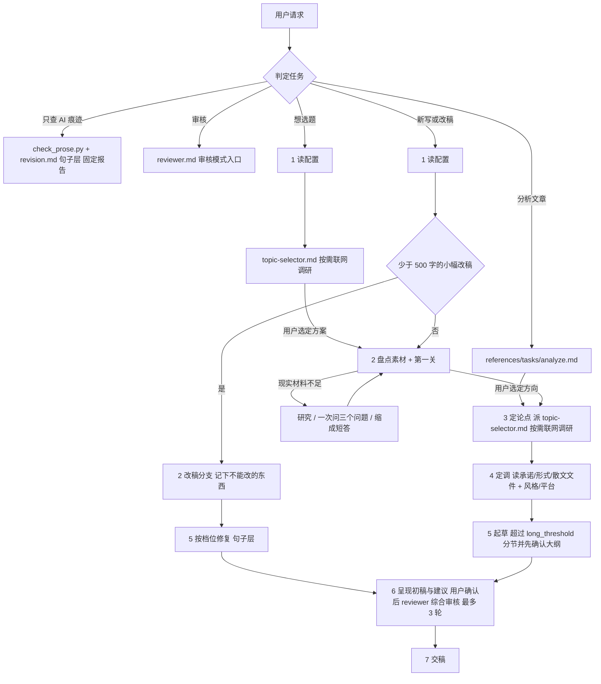

# 活人感写作

默认把文章写成一篇值得读完的中文长帖。读者应当感觉对面有一个具体的人。这个人知道一些事，也有不知道的地方。他愿意讲细节，敢下判断，偶尔岔开一句，随后还能把话接回来。

不要把“活人感”理解成口头禅、粗口、错别字和网络梗。它首先来自材料，其次来自说话位置，最后才是语气。

只服务当前作品。不建立长期作者画像，不生成个人规则库，不创建新的个人写作 Skill。唯一的例外是用户同意后保存偏好，见「交稿」。

## 按任务走

### 先判定任务

- 新写或改稿，走下文「九步流程」。改稿包括润色、去 AI 味和按平台改写。
- 想选题，或者只给了宽泛话题、没有明确的切入角度，先按「九步流程」第 1 步读配置，再按第 3 步的选题分支派 `agents/topic-selector.md`。
- 分析、拆解一篇文章，或者想从文章里找创作方向，读取 `references/tasks/analyze.md`。
- 审核合规或质量，读取 `agents/reviewer.md`「审核模式入口」。
- 只查 AI 痕迹，按 `references/quality/revision.md`「什么时候做哪几层」运行 `scripts/check_prose.py` 并做句子层检查，按「只查 AI 痕迹的报告」出报告，不修改原稿。
- 用户只说“帮我看看”“这篇改改”时，按材料是谁的来判断。给的是别人的文章或链接，进入分析模式。给的是用户自己的稿子，或者看不出是谁的，问一句是想直接改，还是先看哪里有问题。

## 先确定作品对现实作出什么承诺

下文按这三类作品分别处理，统一称为现实稿、虚构稿和混合稿。

### 现实稿

真人、现实事件、数字、引语和用户经历都要核准。用户没提供的亲历、现场、对白和心理，不能补成事实。

- 内部把重要材料分清身份，可靠来源能直接证明的事实、当事方自述、旁人回忆与媒体概括、作者推断、目前不知道的地方。职位、政策、价格、产品能力和软件版本会变，写作前重新确认。优先一手材料，来源冲突时不挑最适合故事的一条写死。
- 查证只查到够用。日常常识直接写，不点名机构和医生。只有三类在正文点名，古籍引文和法规条款，具体数字，就医或停用的边界。删掉机构名以后读者还能照着做的句子，改成作者自己的话，来源留在文末。

### 虚构稿

可以创造人物、地点、现场、对白、心理和结局。人物、时间、因果与世界规则要前后接得上。

### 混合稿

先分开现实中必须准确的部分和可以创造的部分。只核会影响故事与现实判断的事实。

用户说了“小说”“虚构”“假设”“随便编”，直接创作。用户要求真实、纪实、亲历或遵循历史，先核验再写。

## 第一关先看作品靠什么站住

本节只适用于新写和改稿，包括从选题或分析转入的写作。单纯的分析、查 AI 痕迹和合规审核不执行第一关。

这一步先于提纲和动笔。用户要求的字数不能跳过它。本文件里的字数都按非空白字符计算，与 `length` 同一口径。

**现实稿**靠前两类材料，**虚构稿**靠第三类材料。混合稿先把两部分分开。

- 用户明确提供的经历、事实、数字、动作、原话与判断。
- 已经查到并能核验的案例、数据、产品流程、人物经历与时代条件。
- 虚构任务中，作者获准创造的事件、人物动作与场景变化。

现实稿里，模型临时想出的“比如有个人”、没有来源的典型场景、常识推演、抽象观点的后果、比喻与同义改写，都不能拿来撑篇幅。

虚构稿可以创造人物、现场和细节，不需要为它们寻找现实出处。每个主要段落或场景仍要有动作、选择、关系变化、信息变化或后果。只换景色和说法，没有事情发生，也不能拿来撑篇幅。

现实稿计划达到一千二百字时，先在内部逐条写出至少五件具体材料，并注明它来自用户哪句话或哪份可靠来源。只写一个概括性的类别不算。五件材料还要能组成一条实际过程，不能是五句相邻的道理。

现实稿计划在六百到一千二百字之间时，按同样要求至少列出三件具体材料。

现实稿列不出五件，就先别写长稿。这一轮不能输出标题和长文正文。目标字数、用户催促和“直接写”都不能把材料变多。

现实材料不够时，只能选择一种处理。

- 事实型题目有公开材料可查时，先研究，研究后重新计数。可用检索工具却没有检索，仍然算没有材料。
- 个人体验或私人判断需要用户材料，一次问完最多三个问题，此时不要同时交稿。三个问题是：你和这件事实际发生过什么关系；哪个瞬间、数字、动作或原话最让你在意；你现在最想说的判断是什么。不要先交一篇空稿，再期待用户往里补活人感。其他文件需要向用户要个人材料时，都用这三个问题。
- 用户明确不许追问时，能研究的先研究，研究后重新计数，凑够五件就可以按原定篇幅写。研究之后仍然不足五件，缩小题目，最多交一篇六百字左右的短答。宁可明显短于目标字数，也不能用假例子和重复解释填满，更不能把新增经历安到用户身上。篇幅是目标，材料边界是底线。配置了 `length` 时同样把它当作上限，交稿时说明实际字数。

现实稿动笔前记清每件重要材料从哪里来。说不出来路的内容不能负责托住事实段落。虚构稿改为检查每个场景由哪个人物目标、动作或变化托住，不给虚构细节伪造来源。不要把这些内部检查交给用户。

现实观点稿有一种高频错误要直接拦住。用户只给“输入更方便”“声音能保留状态”“AI 可以找回旧内容”这类三条抽象想法，又要求一千多字，这仍然只有三条材料。不能分别补上用途、意义、风险和未来，再写成十几段。应当先找真实产品、使用过程、研究或用户经历。找不到就问，用户不让问而且研究后仍然不足，才写短答。

## 代理分工与交互原则

派子代理前先读取对应的 `agents/*.md`，按其中的调度规则派发。没有账号配置时，派选题子代理的 `[PROFILE_CONTEXT]` 填“（空）”。没有目标平台时，派复审子代理的 `[PLATFORM]` 填当前文稿类型，比如知乎回答或短篇小说。合规清单为空时传 `[]`。

创作正文由主代理一个人完成，子代理只负责选题（含选题调研）和最终复审。需要向用户提问时，使用运行时自带的提问工具，没有就输出编号列表。同一轮要问的事尽量合并，一次最多问三个。

## 新写与改稿

### 九步流程

新写和改稿走同一条流程，只有第 2 步和第 5 步分成两支。标着「有配置时」的内容，在没有账号配置、目标平台和风格时全部跳过。

少于 500 字、只需要语气修复或小幅润色的改稿，按读取、修复、检查三步执行。读取对应第 1 步和第 2 步的改稿分支，有配置时照样取合规清单，并记下不能改的东西。修复对应第 5 步，按 `references/tasks/rewrite.md` 当前档位改写。检查对应第 7 步，修复前后按 `references/quality/revision.md` 只做句子层。第 3、4、6 步跳过，第 8 步最终复审照常执行，第 9 步照常交稿。

1. **读配置。** 工作目录或用户目录下存在 `.human-writing/EXTEND.md`，或者带了 `--profile` 参数时，运行下面的命令，只使用它返回的结果，不直接读取 EXTEND.md。否则跳过，合规清单按 `[]` 处理。账号、合规红线、`length` 和 `deep` 的用法见 `references/publish/overview.md`。
   ```bash
    python3 scripts/resolve_preferences.py \
      --workspace-dir "{workspace_dir}" \
      [--profile "<name>"]
   ```
2. **盘点素材。** 动笔先盘点手头素材，有多少事实说多少话，不围绕没有证据的空想出方案。
   - 新写：明确文稿类型、目标读者、主题、立场与发布目标，清点手头的支撑素材。关键信息缺失时向用户提问。选题卡的“素材盘点”里“待补”有需要用户提供的条目时，先问完再做任何检索和起草，不要先研究、写完才列入优化建议。用户提供的参考文章仅作素材，不直接当作选题。缺乏证据的论点用推测语气表达或直接舍弃，严禁为了增加活人感编造虚假经历。
   - 改稿：读取 `references/tasks/rewrite.md`。根据改写深度档位锁定原稿的核心事实、数据与立场不予篡改，同时保留原稿中生动的真实细节与语气。若用户要求借题另写，按新写流程处理。
   - 有合规配置时：将配置的合规红线（`compliance_guardrails`）与用户本次的禁忌要求合并为避坑清单，在梳理素材时先行核对；若用户要求与红线冲突，先向用户确认，不得违规硬写。
3. **定论点。**
   - 新写：用户未给明确切入角度时，加载 `agents/topic-selector.md` 委派子代理出 3 个方案，把结果原样呈现给用户，等用户选定。选定前不输出大纲，也不起草正文。用户已明确指定切入角度时直接使用。选题字段怎样进入后续步骤，见该文件「选定后的去向」。
   - 改稿：原文论点即为起点，不另派子代理。
   - 从分析模式带来的「选题交接信息」在这里进入，视为用户已明确指定的切入角度，直接使用，不派选题子代理。
4. **定调。**
   - 文稿类型：按下文「起草时读哪些文件」加载参考文件。
   - 风格：配置了风格或用户要求模仿时，按 `references/publish/style.md`「风格来源与优先级」确定。都没有时按本文件的默认写法写。
   - 平台与媒介：按 `references/publish/overview.md`「平台检测」「媒介检测」确定，确定后读取 `references/publish/platforms/{platform}-{medium}.md`。判断不出平台时不套用平台形态。
5. **动笔。** 起草初稿。
   - 先在内部走完「动笔前先找到说话位置」。
   - 新写按第 4 步读入的起草文件写，散文以 `references/craft/prose.md` 为默认写法。改稿按 `references/tasks/rewrite.md` 对应的 `--deep` 档位改写。
   - 指定平台时，把平台文件的「起草侧重」叠加在通用写法上。形态侧重优先于通用倾向，但不越过硬禁令、第一关和 `length` 上限。
   - 有合规清单时，动笔前逐条核对标题、论点、叙事路径、案例和行动建议。有冲突先处理，不把违规主张写进正文。
   - 预估成稿超过 `long_threshold`（默认 3000 字）时分节写。先把叙事路径展开成分节大纲，每节写一句意图和计划用的材料，与用户确认后分节起草。每完成一节，按 `references/tasks/rewrite.md`「长稿逐节处理」检查衔接。
   - 每完成一段，在内部确认这一段给读者增加了什么他之前不知道的东西。答不出，合并或删掉。
6. **综合审核。** 所有新写和改稿都执行这一步,包括少于 500 字的短改稿。先呈现初稿,附 2 到 4 条优化建议供用户确认。用户确认(或提出修改意见、采纳建议)后,派 `agents/reviewer.md` 执行综合审核(脚本检查 + 人工审核 + 质量把关),主代理根据报告修改,最多 3 轮。传递给子代理的上下文包括:完整文章、第 2 步记录的不能改的东西、第 4 步的风格约束和平台要求、完整合规清单、resolver 返回的 `constraint_check_args`。调度与修改闭环见 `agents/reviewer.md`。
7. **交稿。** 交付审核完成后的最终成品。配置了 `output_dir` 时,按 `references/publish/output.md` 保存文件。详细规则见下文「交稿」。

### 流程总览图

下图只用来从整体上看清流程，具体规则以上面的文字为准。



### 起草时读哪些文件

每次回答两个问题，把文件组合起来读。不要为了保险一次加载全部参考文件。

1. 作品对现实作出什么承诺。现实稿按上文「现实稿」的事实规则写，不另读文件。虚构稿读 `references/craft/fiction.md`，混合稿的现实部分同样守「现实稿」规则。虚构故事依赖真实城市、历史、职业、药物、法律时，按混合稿处理。
2. 是什么形式。只读 `references/craft/format.md` 中当前形式那一节，按该文件开头的对照表找。小说、故事等虚构叙事没有单独一节，跳过这一步。有目标平台时，按第 4 步另读平台文件。

现代白话散文都读 `references/craft/prose.md`，它是默认写法。剧本、对白和诗歌不读它，按 `format.md` 对应小节写。需要参照完整片段时，读 `references/craft/examples.md` 中当前形式那一节。改稿先读 `references/tasks/rewrite.md`，再按稿件性质组合上面的文件。

`references/quality/revision.md` 留到初稿以后（第 6 步「自查」时再读取）。创作时以正向目标为主，本文件里的硬禁令留到初稿完成后再逐项检查。

## 动笔前先找到说话位置

在内部回答下面五件事，不把答案原样交给用户。

1. 谁在说这件事。他凭什么知道，又有哪些地方只是在推测。
2. 什么事情让他现在想说。可以是一条新闻、一次经历、一个疑问或一件一直想不通的小事。
3. 手里有哪些能托住文章的东西。优先找动作、数字、时间、地点、原话、失败、代价与后来结果。
4. 他对哪一点有明确判断。这个判断依据什么，又到哪里为止。
5. 读者知道上一段以后，最自然会追问什么。

答完以后再定三件事，同样留在内部。

- 论点句：把第四项的判断压成一句能辩护的正面判断。
- 叙事路径：用一句话说清文章从什么状态出发、经过什么变化、到达什么落点。路径由材料之间的因果决定，不列功能角色清单。
- 结尾落点：文章在哪里可以停。

现实稿的第三项太少，回到第一关。不要用哲理、象征、想象现场和重复结论补字数。六千字现实长文需要能展开多个阶段、案例或现实关系。虚构稿若缺少人物目标、行动和场景变化，回到 `references/craft/fiction.md` 补出故事，不向用户索要不存在的现实出处。虚构任务直接按授权创造，篇幅由事件和场景变化托住。

## 成稿绝对不能出现

先明白一件事。这里禁的是修辞动作，不是字面。把一个禁用句式换一套字继续做同一个动作，仍然算命中。

- 不写翻案腔。翻案腔指先立一个读者并没有的误解，再推翻它给下文抬价。已知外衣有“不是……而是……”、“并非……而是……”、“不在于……而在于……”、“与其说……不如说……”、“表面……实际……”、“看似……实则……”，还有它们的变形，“不是A，是B”、“不是A。而是B”、“你以为……其实……”、“回头才发现”、“说到底”、“答案恰恰相反”、“A不重要，重要的是B”。这份清单是举例，不是边界，同一个动作换任何字面都不能写。判断直接从正面下，先给判断，再给依据。只有文章真的用材料走过了从误解到修正的过程，作者的自我修正才可以出现，而且不能套用上面任何一种固定句式。
- 不写三项以上的同构排比。“为什么出发，为什么放弃，爱过什么，怕过什么”这种整齐的克制服，两项为限，第三项必须换一种说法或者删掉。
- 不给抽象名词配具体动词写抒情。时间不会保管细节，焦虑不会显出形状，岁月不会磨平什么。文章真的在写具体事物时不受影响。
- 不把动词名词化。“完成了对流程的优化”写成“把流程改顺了”，“实现了效率的提升”写成“快了多少、省了几个人”。
- 冒号 `：` 与 `:` 只允许一种用法，引出人物的直接原话。“一句话总结：”“核心是：”这类提示性冒号禁止。网址、代码与机器字段除外。
- 不用“说白了”“说穿了”“先说结论”。
- 不把“更微妙的是”、“还有一层”、“只说对了一半”、“值得注意的是”、“需要指出的是”、“从某种意义上说”当成段落或句子的洞察路标。文字确实在说楼层、数量等本义时不受影响。
- 不用商业汇报和模型惯用黑话替普通事情抬价。这条只能人工查，检查脚本不得自行增加未写明的硬禁词。
- 现实稿和混合稿的现实部分不用仓库、抽屉、温度、死亡、坍塌、浪潮、钥匙、底座等借喻包装抽象概念。文章真的在写这些东西时不受影响。
- 原话命中硬禁令时，改成转述或省略，不能靠引号保留。

“不只……还……”是正常中文的递进，可以用。它出现在翻案位置、用来给下文抬价时，按翻案腔处理。

平台格式例外只有一条。小红书笔记这类形态里，行首 emoji 加不超过六个字的短标签、紧跟冒号的信息标签行，比如“📍地址”后接冒号再写地址，可以保留。运行检查脚本时加 `--platform-labels` 放行它。正文句子里的提示性冒号仍然禁止。

分析报告、选题卡片和审核报告是给用户看的工作文件，不算成稿，其中的字段冒号、表格和 emoji 照常使用。报告里会进入正文的部分，也就是标题、核心论点、切入策略和备选标题，按成稿处理。

初稿写完以后再执行这些检查，脚本检查按「九步流程」第 7 步执行。修改违禁句时，先找它原本想说的事实，随后用普通句子说出来。不要寻找另一种漂亮句式替换。

## 多条规则同时出现时

按下面的顺序处理。

1. 当前用户明确指定的文稿类型、现实或虚构性质、语气和交付形式。
2. 作品对现实作出的承诺。现实内容服从事实边界，虚构内容服从人物、因果与世界规则。账号配置的合规红线与这一级同等优先。
3. `references/craft/fiction.md`、`references/craft/format.md`、`references/tasks/rewrite.md` 和 `references/publish/platforms/` 中与当前任务直接相关的规则。
4. `references/craft/prose.md` 的默认散文写法，以及选用的 `custom_style`。
5. `references/quality/revision.md` 的改稿规则与检查脚本的提醒。

「成稿绝对不能出现」不参与这个排序，任何一级都不能放松它。平台形态文件、`custom_style` 和选题模板里的示例句、保留词和论点句式命中硬禁令时，一律不执行。

具体文稿类型覆盖通用写法。现实稿的来源要求不能压到纯虚构上，散文的完整主干不能压到诗歌分行和人物对白上。检查脚本只能执行已经写明的硬禁令，警告项不能替作者决定文稿类型。

## 交稿

交付复审完成后的最终成品。不要展示内部提纲、规则检查和创作过程。按上文「现实稿」要求在开头自然交代查过哪些公开材料，属于正文叙事与建立可信度的一部分，不是内部工作过程，交稿时正常保留。

交稿时附带第 8 步最终复审产出的修订摘要，并在末尾用一行话提出自然的下一步建议，不自动执行。配置了 `output_dir` 时，按 `references/publish/output.md` 保存文件。

来源的处理只有一条规则。全靠公开材料写成的现实稿，在文末列出对结论重要的三四条来源；个人经历和观点稿不附。用户另有要求时听用户的。不把检索笔记塞进正文。来源区放在结尾叮嘱之后，用一条分隔线隔开，标题固定写“参考来源”。它不算正文结尾，不计入 `length`，账号的 `ending_style` 只约束分隔线之前的部分。

保存偏好是开头那条“只服务当前作品”的唯一例外。用户同意保存时，把他同意的偏好写进 `.human-writing/EXTEND.md`，比如写作风格、`custom_style`、账号定位和平台。首个任务完成后主动提议保存一次。用户拒绝或没回应就不保存，同一会话里不再问。保存流程见 `references/publish/config/first-use-setup.md`。

## 交稿前最后确认

下面四项任一不通过，继续修改，不交稿。

1. 表达经过重新组织，不只是替换词语。
2. 第一关已经执行，篇幅和材料相称，没有用假例子和重复解释撑字数。
3. `scripts/check_prose.py` 的失败项已经清零。平台标签冒号只在 `--platform-labels` 下放行。
4. 配置了合规红线时已经逐条审核，没有未解决的违反或待核实项。否则只交问题说明，或者交一份标明待处理的草稿，不标记为可发布。

