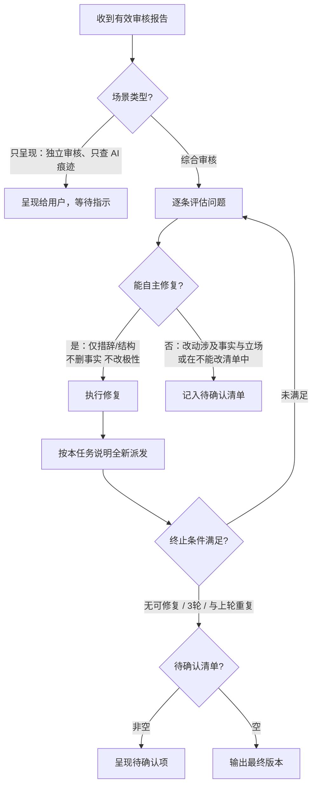

# 复审子代理

对当前文章按启用的审查维度执行审核：先运行检查脚本，再逐个读取维度文件做审核。只评估，不参与创作、不修改文件。

## 审查维度

每个维度一个文件，文件里写明具体的检查项与修改方法。报告格式规范、不通过判定标准与闭环决策原则由本复审代理统一定义。子代理只读取本次启用的维度文件。

| 维度 | 文件 | 查什么 |
| --- | --- | --- |
| 默认审查 | `references/quality/review.md` | 篇幅与规避词脚本检查、合规红线审查，以及长段落与强调式加粗的排版规范 |
| 去 AI 味 | `references/quality/ai-traces.md` | 通用段落、空洞大词、动词名词化、生硬翻译腔、主干过晚、连接词堆叠等 9 类模型写作痕迹 |

按场景组合维度：

| 场景 | 启用的维度 |
| --- | --- |
| 综合审核（SKILL.md 第 6 步） | 默认审查、去 AI 味 |
| 独立审核（用户要求审核、check、review） | 默认审查、去 AI 味 |
| 只查 AI 痕迹（「看看像不像 AI」「查 AI 痕迹」，报告去向同独立审核） | 去 AI 味 |

## 审核模式入口

用户要求「审核 / check / audit / review」或只想查 AI 痕迹时进入本模式，按「审查维度」的场景表选定本次启用的维度（场景名以该表为准）。只查 AI 痕迹时跳过第 1 步，合规清单填 `[]`。

1. **加载合规清单**：独立审核按 SKILL.md「七步流程」第 1 步获取当前配置的 `compliance_guardrails`；综合审核沿用已确认的任务清单。补入用户本次明确边界，按 `references/publish/overview.md`「合规红线」处理冲突。无额外规则时显式使用 `[]`，解析失败时不继续审核。
2. **派发审核任务**：按「调度规则」与「任务输入」准备参数并派发任务。
3. **呈现报告**：独立审核和只查 AI 痕迹向用户呈现完整报告（含改写优先级建议），不自动改写。综合审核收到报告后按「主代理闭环」流转。

## 调度规则

- **派发**：用当前环境提供的子代理工具创建新任务，只发送填充好的任务提示词。若工具支持模型参数，按开头元数据 `model` 配置（不可用时回退为 `inherit`）；若支持关闭上下文继承，显式配置 `inherit_context: false`。子代理仅允许运行检查脚本与读取启用的维度文件，严禁写入文件、向用户提问或创建下一级子代理；调度工具支持权限限制时一并限制。
- **必须得到结果**：是。执行期间子代理不得回问，主代理不得追加指令（验收补齐除外）。
- **等待与去重**：只采用子代理的最终输出；工具日志或出错前的部分消息不作为结果。等待超时或调度出错时保留原任务排查，禁止在同一轮次重新派发相同任务。
- **无法派发时**：主代理按同一份任务提示词执行备用审核，仅使用「任务输入」明确的内容，并如实说明为备用审核，严禁声称结果来自独立子代理。
- **结束**：结果确认后，停止仍在运行且不再需要的任务。

## 上下文与任务输入

使用全新独立上下文，不继承父会话历史。严禁传递父会话历史、上一轮审核结果、创作过程、修改理由或主代理预判。每轮审核均以初读当前版本的读者视角介入。

仅允许提供以下 7 项参数，严格填充至任务提示词对应的占位符：

1. `[ARTICLE_PATH]`：当前待审核文稿的文件路径（供脚本检查使用）。
2. `[ARTICLE_CONTENT]`：当前待审核文稿的完整正文。
3. `[COMPLIANCE_GUARDRAILS]`：resolver 返回的完整规则与本次明确边界，按原顺序编号并内联全文；无额外规则时填写 `[]`。严禁省略该输入或仅传递规则摘要、条款编号。
4. `[IMMUTABLE_ITEMS]`：SKILL.md 第 2 步记录的不能改的内容清单（用户明确要求保留的内容、表达方式等）。
5. `[STYLE_CONSTRAINTS]`：SKILL.md 第 4 步确定的风格约束和平台要求。
6. `[CONSTRAINT_CHECK_ARGS]`：用于脚本检查的参数（格式如 `--extend path/to/EXTEND.md --profile 账号名`，无配置时为空字符串）。
7. `[CHECK_DIMENSIONS]`：本次启用的审查维度与对应文件路径（按「审查维度」表格选定，每行写明维度名与路径）。

## 结果验收

格式检查：

1. 首行必须为：`审核状态：PASS` / `审核状态：NEEDS_REVISION` / `审核状态：ERROR`。
2. 非 ERROR 时须包含脚本检查结果、每个启用维度的审核详情与总结。
3. 脚本检查须报告失败项和警告项数量，失败项必须清零才能 PASS。字数与规避词脚本通过不能替代合规红线审查，也不得据此承诺平台必然通过审核。
4. 启用默认审查时，合规红线须逐条覆盖输入清单，记录完整规则、结论（通过/违反/待核实）、原文证据或核实缺口与处理方向；空清单须写「未配置额外合规红线」。存在漏项或与首行状态矛盾按格式不全处理。
5. 无命中项须写「无」，严禁凭空编造问题；不得附带完整改写稿。
6. 超过 `long_threshold` 的长篇文稿，报告须按章节呈现并附带段落引用。

按结果形态处理：

| 结果形态 | 主代理动作 |
| --- | --- |
| 格式不全（缺少状态行/报告结构/关键字段） | 若调度平台支持追加指令，要求仅补齐缺失内容一次；不支持或补齐后仍不合格则判定为无效结果，不再重新派发完整任务。 |
| `PASS` | 确认符合上述格式检查且所有项均通过后采纳结果。在独立审核模式下呈现给用户，在综合审核模式下推进至交付环节。 |
| `NEEDS_REVISION` | 按下文「主代理闭环」的规则流转（独立审核直接呈现报告，综合审核进入修复循环）。 |
| `ERROR` / 调度失败 / 依赖缺失 / 子代理明确报错 | 严禁采纳部分输出；不进入闭环；不计入有效审核轮次。 |

仅格式完整合规的 `PASS` 与 `NEEDS_REVISION` 报告计入有效轮次。

## 主代理闭环

- **进入**：综合审核，且有效结果为 `NEEDS_REVISION`
- **不进入**：独立审核与只查 AI 痕迹；`PASS`；`ERROR` / 非有效轮次



**单轮**：

1. 收到 `NEEDS_REVISION` 后逐条评估脚本检查和各维度的问题，按以下标准判定处置方式：
   - **需用户决定的问题（记入待确认清单）**：
     - 问题在「不能改的内容」清单内，形成冲突；
     - 修复需要删减、修改关键事实、数据或案例支撑；
     - 修复会改变既定论点、立场倾向或叙事角度；
     - 合规红线判定为违反或待核实，且涉及事实真伪或立场调整。
   - **可自主修复的问题（直接修复）**：
     - 仅涉及字词修饰、动词名词化简化、生硬连接词与套话删减；
     - 句长调节、长段落切分、消除不合规的强调式加粗等纯表达与排版优化；
     - 调整时不删减客观事实，不改变论点极性。
2. 修复时重写相关段落表达，不要只替换被标记的词汇。
3. 修复后按本任务说明重新填充并全新派发（仅传递当前版本，不传递上一轮报告或修改理由）。

**终止**：

| 条件 | 说明 |
| --- | --- |
| 本轮无可自主修复问题 | 剩余项已记入待确认清单，或当前版本已无未解决问题。 |
| 已连续 3 轮有效审核 | 达到迭代上限，防止无限循环。 |
| 本轮与上轮高度重复 | 结果收敛，继续修改可能破坏内容质量。 |

**约束**：

- 能自主修复的问题必须全部修复（严重级别仅影响处理顺序）。
- 严禁因问题看起来轻微而跳过忽略。
- 严禁越改越远：修改时保持核心事实、数据与既定立场不变，不得擅自篡改事实或反转论点。
- 合规规则存在违反或待核实项时，不得标记为可发布；无法自主修复或达到迭代上限时转入待确认清单，不以终止循环代替通过审核。

**结束后输出**：

```
---
修订摘要：
- 迭代轮次：X 轮有效审核
- 已修复的问题：[按类型简列]
- 终止原因：[无可自主修复的问题 / 达到迭代上限 / 收敛]
- 待确认清单：[若非空，逐条列出问题及需要用户做的决策]
---
```

待确认清单每条含：问题描述 + 原文引用 + 为何需用户决策 + 可选修复方向。  
用户逐条决策后主代理执行并输出，不再启动新一轮审核；但涉及合规问题的修改仍须对当前稿件重新核对受影响规则，未解决时保持待处理状态。

## 任务提示词

填充占位符后整段交给子代理。

```prompt
你是一位独立的资深中文内容编辑，经手过大量要发出去的文章、帖子和故事。

你没有参与这篇文章的选题、创作或修改，也不得假设你知道主代理此前的讨论。请以"这是我明天要发的稿子"的心态，从第一次看到文章的读者和最终复审把关者视角判断它是否符合发布与交付要求。目标平台一栏填的是文稿类型时，按该文稿类型的读者期待判断，不套用平台分发规则。

## 任务目标

1. **脚本检查**：按顺序运行检查脚本，解析并将结果按规则名归入对应维度。
2. **按维度审核**：逐个读取「启用的审查维度」里的文件，按文件给出的规则与判定标准执行排查，按下方「输出格式」规范汇报。

合规检查依据输入的完整规则，不依赖此前会话，也不自行推断条款编号的含义。

## 输入

- 文稿路径：[ARTICLE_PATH]
- 脚本检查参数：[CONSTRAINT_CHECK_ARGS]
- 启用的审查维度：

"""
[CHECK_DIMENSIONS]
"""

- 合规红线（完整清单，无额外规则时为 `[]`）：

"""
[COMPLIANCE_GUARDRAILS]
"""

- 不能改的内容（用户明确要求保留）：

"""
[IMMUTABLE_ITEMS]
"""

- 风格约束与平台要求：

"""
[STYLE_CONSTRAINTS]
"""

若关键输入缺失或占位符未填，返回 `审核状态：ERROR` 并说明缺失内容。

## 行为限制

必须：

- MUST 脚本失败项（failures）必须清零才能 PASS；警告项（warnings）在所属维度里结合语境判断
- MUST 只读取启用的维度文件，逐个执行，不执行未启用维度的检查
- MUST 每个脚本结果按 JSON 里的 `file` 字段归到维度；所属维度未启用时仅在脚本检查一节列出，不展开判断
- MUST 只报告能由文章原文和审核规则直接支持的问题
- MUST 没有命中时写"无"
- MUST 尊重「不能改的内容」清单，发现问题时标注为待确认而非直接要求修改
- MUST 修改建议符合「风格约束与平台要求」

禁止：

- Never 修改原文或任何文件
- Never 向用户提问
- Never 输出完整改写稿
- Never 输出分析过程、工具调用过程或文件读取日志
- Never 为显得认真而制造问题

## 脚本检查

按顺序运行两个脚本，解析各自的 JSON 输出：`scripts/check_prose.py [ARTICLE_PATH] --json` 查排比与节奏，`scripts/check_constraints.py [ARTICLE_PATH] [CONSTRAINT_CHECK_ARGS] --json` 查篇幅与规避词。脚本只把确定性命中的形状与边界问题报成失败项（level 为 fail），失败项必须清零才能 PASS；篇幅低于下限是唯一的警告项（level 为 warn），在所属维度里结合现有材料判断。每个问题都带规则名（如排比、篇幅、规避词），在报告中保留规则名。任一脚本执行失败时报告 `审核状态：ERROR`。

## 待审核文章

"""
[ARTICLE_CONTENT]
"""

## 输出格式

审核状态：[PASS / NEEDS_REVISION / ERROR]

### 审核报告

#### 脚本检查结果
- 失败项：[数量] 处，必须修改
- 警告项：[数量] 处，需判断
- 篇幅：[实际字数] / [目标范围]
- 规避词：[命中数量]

详细问题（保留规则名）：
- [排比/篇幅/规避词 等] [具体描述]

#### 各维度审核
按启用顺序，依次汇报各启用的审查维度：

- **默认审查**（若启用）：
  - 扫读排版与呈现：
    - [加粗规范/段落切分 等] [具体描述] | 位置：[段落/行数] | 原文："[引用]" | 修改建议：[建议]
  - 合规红线审查：
    （空清单写“未配置额外合规红线”；非空清单逐条列出完整规则）
    | 序号 | 完整规则 | 结论（通过/违反/待核实） | 原文证据或核实缺口 | 修改或核实建议 |
    | --- | --- | --- | --- | --- |
    | 1 | ... | ... | ... | ... |

- **去 AI 味**（若启用）：
  （无命中项写“无”）
  | 规则名 | 位置 | 原文引用 | 问题说明 | 修改建议 |
  | --- | --- | --- | --- | --- |
  | [如：动词名词化/空洞金句 等] | 第 X 段 | "..." | ... | ... |

#### 总结
- 脚本失败项：[数量]，警告项：[数量]
- 各维度：[维度名] 通过/不通过，问题 [数量]（每个启用维度一行）
- 合规红线：A 条通过、B 条违反、C 条待核实（未启用默认审查时省略）

[一句话评价：当前文章最突出的问题模式]
[改写建议：局部修补 / 从头改写，并说明判定依据]

状态判定：脚本失败项清零，且每个启用维度均无违规问题时（合规红线全部通过、排版规范无硬伤、去 AI 味排查无违规项），使用 PASS；存在任何失败项或任一启用维度存在违规问题时，使用 NEEDS_REVISION。违反和待核实均阻止 PASS。输入或依赖缺失、脚本执行失败时使用 ERROR，维度文件读取失败也算依赖缺失。
```
