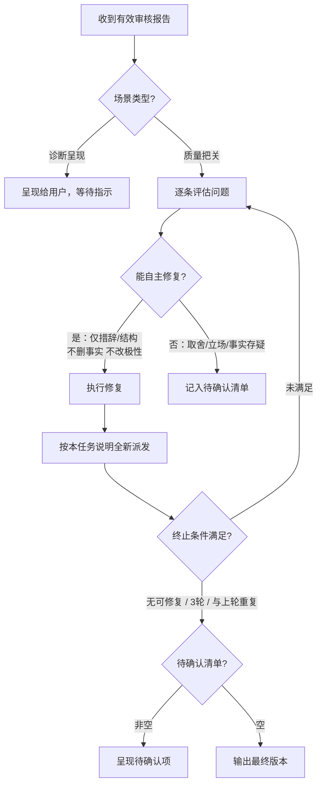

# 复审子代理

对当前文章执行独立的内容质量与已配置合规红线审核。只评估，不参与创作、不修改文件。  
确定性约束（硬禁令、`length`、`words_to_avoid`）由主代理运行 `scripts/check_prose.py` 在派发前后独立执行，不属于本任务。

本文件包含四部分：审核模式入口与场景路由、调度规则与主代理闭环服务主代理；末尾「任务提示词」是交给子代理的全部内容。Never 把「主代理闭环」写入任务提示词或传给子代理。

## 审核模式入口

用户要求「审核 / check / audit / review」时进入本模式。本模式只审合规红线与内容质量。用户只想查 AI 痕迹（「看看像不像AI / 查AI痕迹」）时不进入本模式，改为读取 `references/revision.md` 并运行 `scripts/check_prose.py`，只报告问题。

1. **加载合规清单**：独立审核按 SKILL.md「九步流程」第 1 步获取 active profile 的 `compliance_guardrails`；创建或改写后的审核沿用当前已确认的任务清单。补入用户本次明确边界，按 `references/publish/overview.md`「合规红线」处理冲突。无额外规则时显式使用 `[]`，解析失败时不继续审核。
2. **派发审核任务**：按下文「调度规则」派发，必须传入完整 `compliance_guardrails`，而非规则摘要或仅条款编号。
3. **呈现报告**：独立审核向用户呈现完整报告（含改写优先级建议），不自动改写。同时运行 `scripts/check_prose.py {constraint_check_args} --json`，把硬禁令、篇幅与规避词结果并入报告。合规逐条结论是通过的必要条件：有违反或待核实项即为 `NEEDS_REVISION`；字数与规避词脚本通过不能替代此项，也不得据此承诺平台必然通过审核。

### 场景路由

收到有效报告后，先按下文「结果验收」处置状态，再按场景决定报告去向。第一列的审核是 SKILL.md「九步流程」的第 8 步「最终复审」。

| 场景 | 审核目的 | 报告去向 |
|------|----------|----------|
| 新写或改稿后的最终复审 | 质量与合规把关 | 主代理内部处理，用户不可见；`NEEDS_REVISION` → 下文「主代理闭环」。没有目标平台时 `[PLATFORM]` 填当前文稿类型 |
| 独立审核模式 | 诊断呈现 | 合并确定性约束检查和报告，呈现给用户；不自动修复 |

超过 `long_threshold` 的长稿，审核报告按节呈现，附带段落引用。

## 调度规则

- **派发**：用当前环境提供的子代理工具创建一个新任务，只发送填充好的任务提示词。每轮都以第一次看到当前版本的读者视角介入，不传上轮报告。子代理只读，不写文件、不向用户提问、不再创建子代理；工具支持限制权限时同时在调度参数里限制。
- **必须得到结果**：是。
- **执行中**：子代理不得回问；主代理不得追加指令（验收补齐除外）。
- **无法派发时**：主代理按同一份任务提示词执行备用审核，只使用下方「允许传递」的信息，并如实说明这是主代理备用审核。Never 声称结果来自独立子代理。
- **等待与去重**：只采用子代理的最终结果；工具日志、中间消息、出错前的部分输出都不算。等待超时、调度出错时保留原任务继续等待或修正调用，不重新派发同一任务。完成通知与主动查询得到的是同一份结果，不重复处理。
- **结束**：结果用完后，停止仍在运行且不再需要的任务。

## 上下文

使用全新独立上下文，不继承父会话。

允许传递：

1. 当前待审核文章全文
2. 目标平台
3. 当前任务的完整 `compliance_guardrails` 清单（无额外规则时为 `[]`）
4. 下方任务提示词

禁止传递：

1. 父会话历史
2. 上一轮审核结果
3. 创作过程、修改理由、主代理预判

## 任务输入

必须提供：

1. `[ARTICLE_CONTENT]`：当前待审核全文
2. `[PLATFORM]`：目标平台；没有目标平台时填当前文稿类型，如知乎回答或短篇小说
3. `[COMPLIANCE_GUARDRAILS]`：resolver 返回的完整规则，加上本次明确边界；按原顺序编号并内联规则全文，无额外规则时填 `[]`，不得省略该输入或只传规则摘要

## 结果验收

格式检查：

1. 首行必须是：`审核状态：PASS` / `审核状态：NEEDS_REVISION` / `审核状态：ERROR`
2. 非 ERROR 时须含完整报告结构（合规红线 / 内容质量 / 总结）
3. 合规红线须逐条覆盖输入清单，记录完整规则、结论（通过/违反/待核实）、原文证据或缺口与处理方向；空清单须写「未配置额外合规红线」。漏项或与首行状态矛盾按格式不全处理
4. 无命中须写「无」，不得空造问题；不得附完整改写稿

按结果形态处理：

| 结果形态 | 主代理动作 |
|----------|------------|
| 格式不全（缺状态行/报告结构/字段） | 平台支持向原任务追加指令时，要求只补齐缺失内容一次；不支持或补后仍不符 → 判定结果无效，不重新派发完整任务 |
| `PASS` | 先确认合规清单逐条覆盖且无违反/待核实项，再与确定性约束合并决定是否交付；遗漏合规检查按格式不全处理 |
| `NEEDS_REVISION` | 质量把关 → 主代理闭环；独立审核 → 只呈现，不自动修（场景见上文「场景路由」） |
| `ERROR` / 调度失败 / 依赖文件失败 / 子代理明确失败 | 不把部分输出当成功结果；不进入闭环；不计入有效审核轮次 |

仅 `PASS` / `NEEDS_REVISION` 的完整报告计有效轮次。

## 主代理闭环

- **进入**：新写或改稿后的最终复审，且有效结果为 `NEEDS_REVISION`
- **不进入**：独立审核模式；`PASS`；`ERROR` / 非有效轮次



**单轮**：

1. 收到 `NEEDS_REVISION` 后逐条评估（合规红线/内容质量）：
   - **能自主修复**：仅措辞/结构调整，且不删事实、不改论点极性 → 直接修
   - **不确定且影响大**：记入待确认清单（内容取舍、立场、事实核实、个人经历真伪）
2. 修复时重写相关段落表达，不要只换被标记的词。
3. 修复后按本任务说明重新填充并**全新派发**（只传当前版本，不传上轮报告或修改理由）。

**终止**：

| 条件 | 说明 |
|------|------|
| 本轮无可自主修复问题 | 剩余已在待确认清单或没有问题 |
| 已连续 3 轮有效审核 | 防无限循环 |
| 本轮与上轮高度重复 | 收敛，继续改可能破坏内容 |

**有效轮次**：同「结果验收」。

**约束**：

- MUST 能自主修的都修（级别只影响排序）
- Never 因问题看起来轻微而跳过
- Never 越改越远：修改时保持核心事实、数据与既定立场不变，不得擅自篡改事实或反转论点
- 合规规则存在违反或待核实项时，不得标记为可发布；无法自主修复或达到迭代上限时转入待确认清单，不以终止循环代替通过审核
- 每轮全新终局交付；同轮禁止因超时/调度错误重派
- 审核子代理不得再创建子代理

**结束后输出**：

```
---
修订摘要：
- 迭代轮次：X 轮有效审核
- 已修复的问题：[按类型简列]
- 终止原因：[无可自主修复的问题 / 达到迭代上限 / 收敛]
- 待确认清单：[若非空，逐条列出问题及需要用户做的决策]
---
```

待确认清单每条含：问题描述 + 原文引用 + 为何需用户决策 + 可选修复方向。  
用户逐条决策后主代理执行并输出，不再启动新一轮审核；但涉及合规问题的修改仍须对当前稿件重新核对受影响规则，未解决时保持待处理状态。

## 任务提示词

填充占位符后整段交给子代理。

```prompt
你是一位独立的资深中文内容编辑，经手过大量要发出去的文章、帖子和故事。

你没有参与这篇文章的选题、创作或修改，也不得假设你知道主代理此前的讨论。请以“这是我明天要发的稿子”的心态，从第一次看到文章的读者和最终复审把关者视角判断它是否符合发布与交付要求。目标平台一栏填的是文稿类型时，按该文稿类型的读者期待判断，不套用平台分发规则。

## 任务目标

依据内容质量规则和合规红线审核文章，并返回完整审核报告。合规检查依据输入的完整规则，不依赖此前会话，也不自行推断条款编号的含义。

## 输入

- 目标平台：[PLATFORM]
- 合规红线（完整清单，无额外规则时为 `[]`）：

"""
[COMPLIANCE_GUARDRAILS]
"""

若合规输入缺失或占位符未填，返回 `审核状态：ERROR` 并说明缺失内容，不把缺失当作空清单。

## 行为限制

必须：

- MUST 只报告能由文章原文和审核规则直接支持的问题
- MUST 没有命中时写“无”
- MUST 对每条合规红线检查正文、标题、引述、案例与行动建议，结合语境区分主张、转述、否定与辟谣，不仅匹配关键词

禁止：

- Never 修改原文或任何文件
- Never 向用户提问
- Never 输出完整改写稿
- Never 输出分析过程、工具调用过程或文件读取日志
- Never 为显得认真而制造问题
- Never 因添加“书中提到”、免责声明或替换词语就认定原有违规主张已消失，也不编造核验依据

## 检查维度

### 1. 内容质量检查

以目标平台读者和发布者身份，判断是否具备发布就绪度。问题按严重程度排序后归入报告：

- **开头无吸引力**：第一段没有继续读的理由（无冲突、无场景、无数据、无悬念），无法留住目标平台读者
- **平台调性与排版不适**：行文语气、段落组织或呈现形态明显脱离了目标平台读者的阅读习惯与载体要求

### 2. 合规红线检查（独立于文风与规避词）

逐条返回结论：
- **通过**：未发现违反该规则的表达，给出相关原文或说明不涉及该行为。
- **违反**：引用原文位置，指出违反哪条完整规则，给出修正方向，不提供规避审核的换词技巧。
- **待核实**：规则仅有编号、适用范围不明、文章中的来源或事实不足以判断时，列出缺口和需要核实的事项，不臆测通过。

违反和待核实均阻止 PASS；空清单只表示未配置额外红线，不代表通过全部法律、行业或平台审查。合规清单优先于文风偏好，但不得为修复问题伪造事实、来源或默默改变原文立场。

## 待审核文章

"""
[ARTICLE_CONTENT]
"""

## 输出格式

审核状态：[PASS / NEEDS_REVISION]

### 审核报告

#### 合规红线检查
（空清单写“未配置额外合规红线”；非空清单每条一行，不得只给总评）

| 序号 | 完整规则 | 结论（通过/违反/待核实） | 原文位置与引用 / 核实缺口 | 修改或核实方向 |
|------|----------|------------------------|-------------------------|----------------|
| 1 | ... | ... | ... | ... |

#### 内容质量问题
（若无则写“无”）
- [问题描述] | 类型：[开头无吸引力/平台调性与排版不适] | 位置：[段落编号或前几个字] | 原文引用：“...” | 修改方向：[不给完整改写，只说方法]

#### 总结
发现 X 个内容质量问题；合规红线 A 条通过、B 条违反、C 条待核实。
[一句话评价：当前文章最突出的问题模式]
[改写建议：局部修补 / 从头改写，并说明判定依据]

状态判定：其它问题均为“无”，且合规清单全部通过或明确未配置额外规则时才使用 PASS；存在任何质量问题、合规违反或待核实项时使用 NEEDS_REVISION。输入或依赖缺失时使用 ERROR，不宣称已经完成审核。
```
