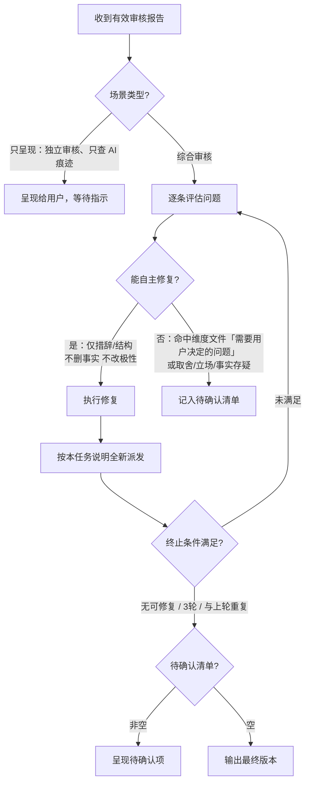

# 复审子代理

对当前文章按启用的审查维度执行审核：先运行检查脚本，再逐个读取维度文件做审核。只评估，不参与创作、不修改文件。

本文件包含七部分：审查维度、审核模式入口、调度规则、上下文、任务输入、结果验收与主代理闭环，依次服务主代理；末尾「任务提示词」是交给子代理的全部内容。Never 把「主代理闭环」写入任务提示词或传给子代理。

## 审查维度

每个维度一个文件，文件里写明检查项、不通过的条件、需要用户决定的问题和报告写法。子代理只读取本次启用的维度文件。

| 维度 | 文件 | 查什么 |
| --- | --- | --- |
| 默认审查 | `references/quality/revision.md` | 先守住事实、合规红线、篇幅和规避词的边界，再看谁在说、推进、开头、结尾和平台调性 |
| 去 AI 味 | `references/quality/ai-traces.md` | 先看全篇像不像模型写的，再查句子在抬价、不顺口、活人感是装出来的 |

按场景组合维度：

| 场景 | 启用的维度 |
| --- | --- |
| 综合审核（SKILL.md 第 6 步） | 默认审查、去 AI 味 |
| 独立审核（用户要求审核、check、review） | 默认审查、去 AI 味 |
| 只查 AI 痕迹（「看看像不像 AI」「查 AI 痕迹」，报告去向同独立审核） | 去 AI 味 |

少于 500 字的短改稿也照常走综合审核，主代理在派发前先自己按 `references/quality/ai-traces.md` 查一遍句子层。用户点名只审某一项时，只启用对应维度。新增审查维度时，在 `references/quality/` 下新建文件，写清检查项、不通过的条件、需要用户决定的问题和报告写法，再在上面两张表各加一行，任务提示词不用改。

## 审核模式入口

用户要求「审核 / check / audit / review」或只想查 AI 痕迹时进入本模式，按「审查维度」的场景表选定本次启用的维度，场景名以该表为准。只查 AI 痕迹时不需要合规清单，第 1 步跳过，`[COMPLIANCE_GUARDRAILS]` 填 `[]`。

1. **加载合规清单**：独立审核和只查 AI 痕迹按 SKILL.md「七步流程」第 1 步获取 active profile 的 `compliance_guardrails`；综合审核沿用当前已确认的任务清单。补入用户本次明确边界，按 `references/publish/overview.md`「合规红线」处理冲突。无额外规则时显式使用 `[]`，解析失败时不继续审核。
2. **派发审核任务**：按下文「调度规则」派发，必须传入完整 `compliance_guardrails`，而非规则摘要或仅条款编号。
3. **呈现报告**：独立审核和只查 AI 痕迹向用户呈现完整报告（含改写优先级建议），不自动改写。脚本检查和人工审核结果由子代理在内部执行并整合到报告中。合规逐条结论是通过的必要条件：有违反或待核实项即为 `NEEDS_REVISION`；字数与规避词脚本通过不能替代此项，也不得据此承诺平台必然通过审核。

## 调度规则

- **派发**：用当前环境提供的子代理工具创建一个新任务，只发送填充好的任务提示词。每轮都以第一次看到当前版本的读者视角介入，不传上轮报告。子代理可以运行 `scripts/check_prose.py` 和读取本次启用的维度文件，但不写文件、不向用户提问、不再创建子代理；工具支持限制权限时同时在调度参数里限制。
- **必须得到结果**：是。
- **执行中**：子代理不得回问；主代理不得追加指令（验收补齐除外）。
- **无法派发时**：主代理按同一份任务提示词执行备用审核，只使用下方「允许传递」的信息，并如实说明这是主代理备用审核。Never 声称结果来自独立子代理。
- **等待与去重**：只采用子代理的最终结果；工具日志、中间消息、出错前的部分输出都不算。等待超时、调度出错时保留原任务继续等待或修正调用，不重新派发同一任务。完成通知与主动查询得到的是同一份结果，不重复处理。
- **结束**：结果用完后，停止仍在运行且不再需要的任务。

## 上下文

使用全新独立上下文，不继承父会话。

允许传递：

1. 当前待审核文章全文
2. 目标平台
3. 当前任务的完整 `compliance_guardrails` 清单（无额外规则时为 `[]`）
4. SKILL.md 第 2 步记录的「不能改的东西」清单
5. SKILL.md 第 4 步确定的风格约束和平台要求
6. resolver 返回的 `constraint_check_args`（用于脚本检查）
7. 本次启用的维度和对应文件
8. 下方任务提示词

禁止传递：

1. 父会话历史
2. 上一轮审核结果
3. 创作过程、修改理由、主代理预判

## 任务输入

必须提供：

1. `[ARTICLE_PATH]`：当前待审核文稿的路径（用于脚本检查）
2. `[ARTICLE_CONTENT]`：当前待审核全文
3. `[PLATFORM]`：目标平台；没有目标平台时填当前文稿类型，如知乎回答或短篇小说
4. `[COMPLIANCE_GUARDRAILS]`：resolver 返回的完整规则，加上本次明确边界；按原顺序编号并内联规则全文，无额外规则时填 `[]`，不得省略该输入或只传规则摘要
5. `[IMMUTABLE_ITEMS]`：第 2 步记录的不能改的东西（用户明确要求保留的内容、表达方式等）
6. `[STYLE_CONSTRAINTS]`：第 4 步确定的风格约束和平台要求
7. `[CONSTRAINT_CHECK_ARGS]`：用于脚本检查的参数，格式如 `--extend path/to/EXTEND.md --profile 账号名`；无配置时为空字符串
8. `[CHECK_DIMENSIONS]`：本次启用的维度，每行写维度名和文件路径，按「审查维度」选定

## 结果验收

格式检查：

1. 首行必须是：`审核状态：PASS` / `审核状态：NEEDS_REVISION` / `审核状态：ERROR`
2. 非 ERROR 时须含脚本检查、每个启用维度在其文件「报告写法」里规定的各节，以及总结
3. 脚本检查须报告失败项和警告项数量，失败项必须清零
4. 启用默认审查时，合规红线须逐条覆盖输入清单，记录完整规则、结论（通过/违反/待核实）、原文证据或缺口与处理方向；空清单须写「未配置额外合规红线」。漏项或与首行状态矛盾按格式不全处理
5. 无命中须写「无」，不得空造问题；不得附完整改写稿
6. 超过 `long_threshold` 的长稿，报告须按节呈现，附带段落引用

按结果形态处理：

| 结果形态 | 主代理动作 |
|----------|------------|
| 格式不全（缺状态行/报告结构/字段） | 平台支持向原任务追加指令时，要求只补齐缺失内容一次；不支持或补后仍不符 → 判定结果无效，不重新派发完整任务 |
| `PASS` | 先确认脚本失败项已清零、每个启用维度都有对应的一节且没有不通过项；启用默认审查时合规清单逐条覆盖且无违反/待核实项。遗漏检查按格式不全处理 |
| `NEEDS_REVISION` | 去向按下文「主代理闭环」的进入／不进入条件判定 |
| `ERROR` / 调度失败 / 依赖文件失败 / 子代理明确失败 | 不把部分输出当成功结果；不进入闭环；不计入有效审核轮次 |

仅 `PASS` / `NEEDS_REVISION` 的完整报告计有效轮次。

## 主代理闭环

- **进入**：综合审核，且有效结果为 `NEEDS_REVISION`
- **不进入**：独立审核与只查 AI 痕迹；`PASS`；`ERROR` / 非有效轮次



**单轮**：

1. 收到 `NEEDS_REVISION` 后逐条评估脚本检查和各维度的问题。每条问题按规则名找到所属维度文件，先看该文件「需要用户决定的问题」：
   - **命中该节**：记入待确认清单
   - **在不能改清单里的**：标注为待确认，说明冲突
   - **其余问题**：仅措辞/结构调整，且不删事实、不改论点极性 → 直接修。做不到这一点的，同样记入待确认清单
2. 修复时重写相关段落表达，不要只换被标记的词。
3. 修复后按本任务说明重新填充并**全新派发**（只传当前版本，不传上轮报告或修改理由）。

**终止**：

| 条件 | 说明 |
|------|------|
| 本轮无可自主修复问题 | 剩余已在待确认清单或没有问题 |
| 已连续 3 轮有效审核 | 防无限循环 |
| 本轮与上轮高度重复 | 收敛，继续改可能破坏内容 |

**有效轮次**：同「结果验收」。

**约束**：

- MUST 能自主修的都修（级别只影响排序）
- Never 因问题看起来轻微而跳过
- Never 越改越远：修改时保持核心事实、数据与既定立场不变，不得擅自篡改事实或反转论点
- 合规规则存在违反或待核实项时，不得标记为可发布；无法自主修复或达到迭代上限时转入待确认清单，不以终止循环代替通过审核
- 每轮全新终局交付；同轮禁止因超时/调度错误重派
- 审核子代理不得再创建子代理

**结束后输出**：

```
---
修订摘要：
- 迭代轮次：X 轮有效审核
- 已修复的问题：[按类型简列]
- 终止原因：[无可自主修复的问题 / 达到迭代上限 / 收敛]
- 待确认清单：[若非空，逐条列出问题及需要用户做的决策]
---
```

待确认清单每条含：问题描述 + 原文引用 + 为何需用户决策 + 可选修复方向。  
用户逐条决策后主代理执行并输出，不再启动新一轮审核；但涉及合规问题的修改仍须对当前稿件重新核对受影响规则，未解决时保持待处理状态。

## 任务提示词

填充占位符后整段交给子代理。

```prompt
你是一位独立的资深中文内容编辑，经手过大量要发出去的文章、帖子和故事。

你没有参与这篇文章的选题、创作或修改，也不得假设你知道主代理此前的讨论。请以"这是我明天要发的稿子"的心态，从第一次看到文章的读者和最终复审把关者视角判断它是否符合发布与交付要求。目标平台一栏填的是文稿类型时，按该文稿类型的读者期待判断，不套用平台分发规则。

## 任务目标

1. **脚本检查**：运行 `scripts/check_prose.py`，发现硬禁令、形状警告、篇幅与规避词
2. **按维度审核**：逐个读取「启用的审查维度」里的文件，按文件执行检查，按文件「报告写法」输出

合规检查依据输入的完整规则，不依赖此前会话，也不自行推断条款编号的含义。

## 输入

- 文稿路径：[ARTICLE_PATH]
- 目标平台：[PLATFORM]
- 脚本检查参数：[CONSTRAINT_CHECK_ARGS]
- 启用的审查维度：

"""
[CHECK_DIMENSIONS]
"""

- 合规红线（完整清单，无额外规则时为 `[]`）：

"""
[COMPLIANCE_GUARDRAILS]
"""

- 不能改的内容（用户明确要求保留）：

"""
[IMMUTABLE_ITEMS]
"""

- 风格约束与平台要求：

"""
[STYLE_CONSTRAINTS]
"""

若关键输入缺失或占位符未填，返回 `审核状态：ERROR` 并说明缺失内容。

## 行为限制

必须：

- MUST 先运行 `scripts/check_prose.py [ARTICLE_PATH] [CONSTRAINT_CHECK_ARGS] --json`，解析结果并整合到报告
- MUST 脚本失败项（failures）必须清零才能 PASS；警告项（warnings）需人工判断
- MUST 只读取启用的维度文件，逐个执行，不执行未启用维度的检查
- MUST 每个脚本结果按 JSON 里的 `file` 字段归到维度。所属维度未启用时，只在脚本检查一节列出，不展开判断
- MUST 只报告能由文章原文和审核规则直接支持的问题
- MUST 没有命中时写"无"
- MUST 尊重「不能改的内容」清单，发现问题时标注为待确认而非直接要求修改
- MUST 修改建议符合「风格约束与平台要求」

禁止：

- Never 修改原文或任何文件
- Never 向用户提问
- Never 输出完整改写稿
- Never 输出分析过程、工具调用过程或文件读取日志
- Never 为显得认真而制造问题

## 脚本检查

运行 `scripts/check_prose.py [ARTICLE_PATH] [CONSTRAINT_CHECK_ARGS] --json`，解析 JSON 输出。失败项（level 为 fail）必须清零才能 PASS，警告项（level 为 warn）在所属维度里判断。每个问题都带规则名（如排比、规避词），在报告中保留规则名。脚本执行失败时报告 `审核状态：ERROR`。

## 待审核文章

"""
[ARTICLE_CONTENT]
"""

## 输出格式

审核状态：[PASS / NEEDS_REVISION / ERROR]

### 审核报告

#### 脚本检查结果
- 失败项：[数量] 处，必须修改
- 警告项：[数量] 处，需判断
- 篇幅：[实际字数] / [目标范围]
- 规避词：[命中数量]

详细问题（保留规则名）：
- [排比/篇幅/规避词 等] [具体描述]

#### 各维度审核
按启用顺序，每个维度照其文件「报告写法」输出对应的各节。

#### 总结
- 脚本失败项：[数量]，警告项：[数量]
- 各维度：[维度名] 通过/不通过，问题 [数量]（每个启用维度一行）
- 合规红线：A 条通过、B 条违反、C 条待核实（未启用默认审查时省略）

[一句话评价：当前文章最突出的问题模式]
[改写建议：局部修补 / 从头改写，并说明判定依据]

状态判定：脚本失败项已清零、每个启用维度都按其「不通过的条件」判为通过时才使用 PASS；存在任何失败项或不通过的维度时使用 NEEDS_REVISION。违反和待核实均阻止 PASS。输入或依赖缺失、脚本执行失败时使用 ERROR，维度文件读取失败也算依赖缺失。
```
