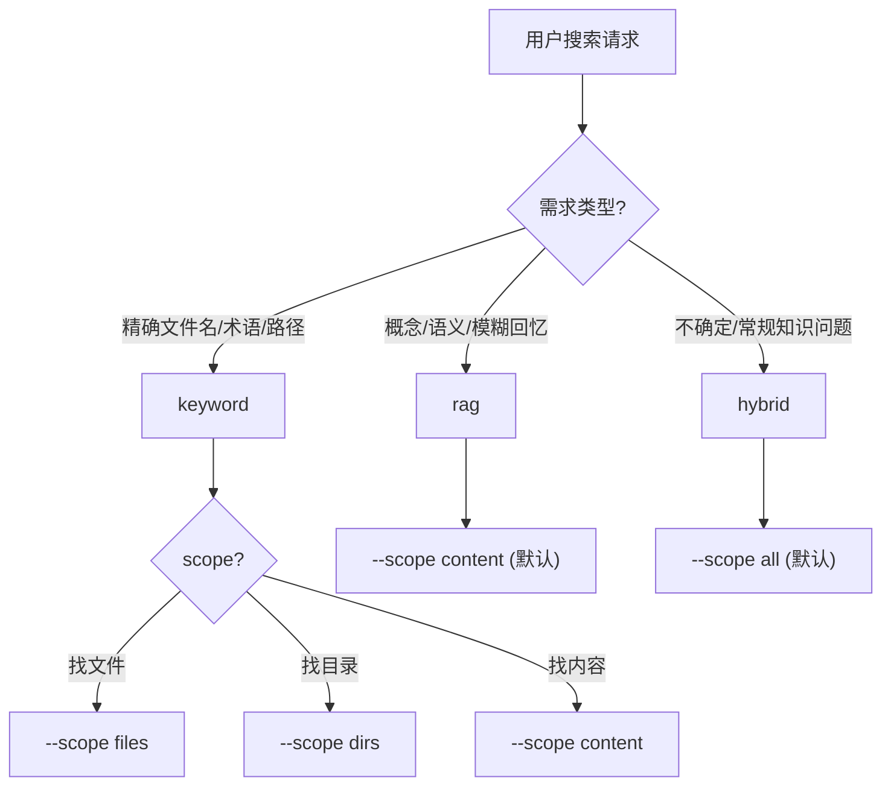
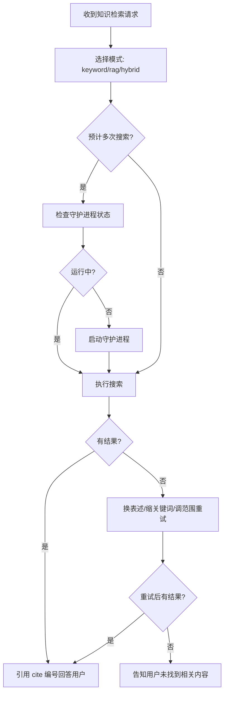

# 知识搜索

当用户要求搜索其 Obsidian 库、笔记、个人知识库、先前写作、存储的参考资料或归档时，使用此技能。

<critical-rules>

1. MUST 始终使用 `--format json` 输出——因为 JSON 是唯一稳定的机器可读格式
2. MUST 在引用搜索结果内容时标注 `cite` 编号——因为无引用的回答不可验证
3. Never 传入绝对路径或包含 `../` 的路径给 `--path`/`--workspace-include`/`--workspace-exclude`——因为路径安全校验会拒绝这些输入
4. Never 编造引用编号或将文件/目录结果当作内容证据引用——因为这会误导用户
5. MUST 结果为空时主动重试（换表述、缩关键词、调路径范围）——因为首次搜索未命中不等于信息不存在

</critical-rules>

## 路径约定

| 变量 | 路径 |
|------|------|
| `$VAULT` | `/Users/mine/GDrive/allyn.yonge/Obsidan_DB/google_obsidian_db` |
| `$DAEMON` | `http://127.0.0.1:47783` |

命令统一通过 `obsidian-search` 调用（需确保 `~/.bun/bin` 在 PATH 中）。

## 模式选择决策

收到搜索请求后，按以下逻辑选择模式：



**快速决策表**：

| 用户意图 | 模式 | scope | 示例 |
|----------|------|-------|------|
| 找特定文件 | `keyword` | `files` | "我的读书笔记在哪" |
| 搜索精确术语 | `keyword` | `content` | "哪些笔记提到了 RAG" |
| 语义理解/概念联想 | `rag` | — | "关于知识管理的思考" |
| 常规知识库提问 | `hybrid` | `all` | "AI 产品设计相关笔记" |
| 某目录下的相关内容 | `hybrid` | `all` + `--path` | "domains 目录下关于投资的内容" |

## 搜索命令

标准调用格式：

```bash
obsidian-search search --query "<query>" --mode hybrid --scope all --format json
```

`search` 子命令自动检测守护进程：可用则走守护进程，不可用则回退到直接搜索。

### 完整参数列表

| 参数 | 说明 | 默认值 |
|------|------|--------|
| `--query <text>` | 搜索查询（content/rag/hybrid 必需） | — |
| `--mode keyword\|rag\|hybrid` | 搜索模式 | `hybrid` |
| `--scope files\|dirs\|content\|all` | 搜索范围 | `all` |
| `--path <vault-relative-path>` | 限定库相对文件夹或文件 | — |
| `--max-results <1-300>` | 最大结果数 | `20` |
| `--case-sensitive` | 仅关键词匹配，区分大小写 | `false` |
| `--rag-min-similarity <0-1>` | 覆盖 RAG 相似度阈值 | `0.35` |
| `--rag-limit <integer>` | 覆盖融合前 RAG 块获取数量 | `80` |
| `--workspace-include <path>` | 包含过滤器（可重复） | — |
| `--workspace-exclude <path>` | 排除过滤器（可重复） | — |
| `--config <path>` | 配置文件路径 | `$CONFIG` |
| `--format json\|pretty` | 输出格式 | — |

## 模式行为

### `keyword` — 文件系统关键词搜索

不调用嵌入、不查询向量数据库。速度最快。

适用：精确术语、文件名查找、目录浏览、快速本地匹配。

```bash
obsidian-search search --query "Obsidian" --mode keyword --scope files --max-results 5 --format json
obsidian-search search --query "AI 产品设计" --mode keyword --scope content --path "3. domains" --format json
```

### `rag` — 语义向量检索

以只读方式查询 YOLO 插件的 PGlite 向量数据库（`$VAULT/<YOLO baseDir>/.yolo_vector_db.tar.gz`），使用与 YOLO 相同的嵌入提供商生成查询向量。

适用：语义召回、概念搜索、措辞不确定的检索。

```bash
obsidian-search search --query "知识管理方法论" --mode rag --max-results 5 --format json
```

### `hybrid` — 混合检索（默认）

融合关键词 + RAG + RRF 排序 + 内容聚合 + 引用生成。覆盖面最广。

如果 RAG 不可用，自动回退到纯关键词搜索，输出中包含 `fallbackReason`。

```bash
obsidian-search search --query "AI 产品设计" --mode hybrid --scope all --path "3. domains" --max-results 5 --format json
```

## 守护进程管理

守护进程一次性加载向量数据库到内存，大幅加速重复搜索。

| 操作 | 命令 |
|------|------|
| 查状态 | `obsidian-search daemon:status` |
| 启动 | `obsidian-search daemon` |
| 停止 | `obsidian-search daemon:stop` |

**管理策略**：
- 预计同会话 ≥3 次搜索 → 先启动守护进程
- 守护进程启动后输出 `obsidian-search daemon listening` 表示正常，它是持久服务
- 仅在用户明确要求或会话结束清理时停止

## 输出结构

```json
{
  "tool": "knowledge_search",
  "requestedMode": "hybrid",
  "effectiveMode": "hybrid",
  "fallbackReason": "... 可选，RAG 不可用时说明原因 ...",
  "scope": "content",
  "query": "...",
  "path": "$VAULT/...",
  "results": [
    {
      "kind": "content_group",
      "path": "notes/example.md",
      "source": "hybrid",
      "matchType": "dual",
      "score": 0.123,
      "hitCount": 2,
      "snippets": [
        {
          "cite": 1,
          "startLine": 12,
          "endLine": 18,
          "page": 3,
          "snippet": "...",
          "source": "rag",
          "similarity": 0.72,
          "rrfScore": 0.016
        }
      ]
    }
  ],
  "citations": [
    { "cite": 1, "path": "notes/example.md", "startLine": 12, "endLine": 18, "page": 3, "snippet": "...", "similarity": 0.72, "source": "rag" }
  ],
  "stats": { "scannedFiles": 0, "scannedContentFiles": 0, "skippedFiles": [], "durationMs": 500 }
}
```

`content_group` 表示同一文件的多个片段已被分组。使用 `snippets` 和顶层 `citations` 作为证据来源。

## 引用规则

| 场景 | 引用格式 |
|------|----------|
| Markdown 文件 | `[N] path:startLine-endLine` |
| PDF 文件（有 page） | `[N] path p.page` |

**约束**：
- MUST 使用搜索返回的 `cite` 编号，Never 编造
- Never 将文件/目录结果（无内容片段）作为证据引用
- Never 使用 `yolo-cite:` 链接（除非活动客户端明确支持）

## 故障处理

| 症状 | 诊断 | 应对 |
|------|------|------|
| 搜索结果为空 | 关键词太长/太具体 | 缩短查询、换同义词、放宽 `--path` 范围 |
| `fallbackReason` 出现 | RAG 不可用 | 运行 `obsidian-search doctor --format json` 检查向量数据库状态 |
| 守护进程连接失败 | 进程未启动或已崩溃 | `obsidian-search daemon:status` 检查 → 重新启动 |
| 配置/路径错误 | config.json 异常 | `obsidian-search doctor --format json` 全面检查 |
| 搜索超时或卡住 | 数据库损坏或文件过大 | 检查 `stats.skippedFiles`，缩小搜索范围 |

### Doctor 诊断

检查配置、库路径、YOLO 插件设置、PGlite 向量数据库、运行时和嵌入状态：

```bash
obsidian-search doctor --format json
```

当任何搜索行为异常时，优先运行此命令获取完整诊断信息。

## 代理执行流程



**核心原则**：搜索是为了回答用户问题。MUST 优先返回有引用支撑的答案；Never 在有结果时仅列出文件路径而不提取关键内容。
