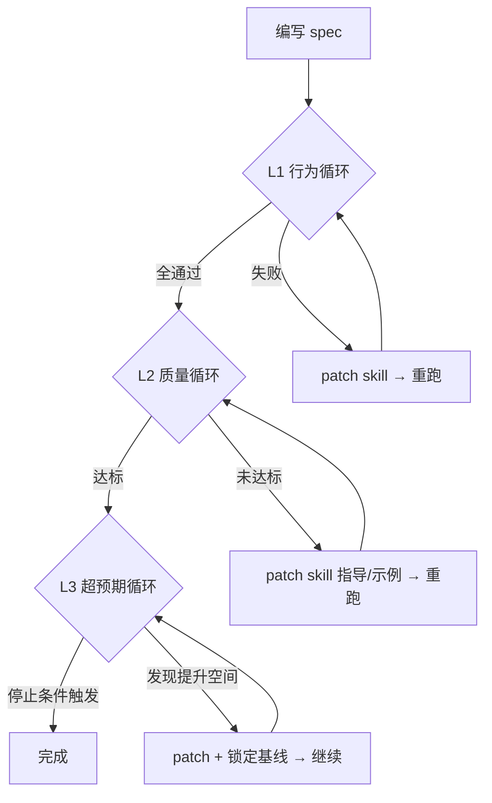

# Skill 行为测试

<critical-rules>
1. MUST 先写失败测试定义再修补 skill（RED：预期失败）—— 没有失败证据的修补是无目标的
2. MUST 每次只修一个 case，验证通过后再处理下一个 —— 批量修补无法隔离因果
3. MUST 质量迭代中行为回归时立即回滚并终止质量循环 —— 行为正确优先于质量分数
4. MUST 超预期迭代中每次进步锁定为新基线 —— 已证明可达的水平 Never 允许回退
</critical-rules>

## 概述

在隔离环境中运行真实 AI agent 轮次，捕获完整轨迹（stdout/stderr/会话记录），通过混合断言管线（确定性检查 + 语义评审 + 质量评分）验证 skill 行为，修补目标 `SKILL.md`，循环直到通过并超越。

本框架遵循 Eval-Driven Development 范式：eval 驱动 skill 改进，而非 skill 改完再补测试。

### 三层递进架构



| 层级 | 职责 | 终止条件 | 详细决策树 |
|------|------|----------|-----------|
| **L1 行为循环** | RED（预期失败）→ patch → GREEN（修补后通过），确保 skill 行为正确 | 所有断言通过 或 3 次迭代仍失败 | [iteration-loops.md §L1](references/iteration-loops.md) |
| **L2 质量循环** | 多维度评分 → patch 指导/示例 → 达标 | 质量阈值通过 或 max_iterations 耗尽 | [iteration-loops.md §L2](references/iteration-loops.md) |
| **L3 超预期循环** | Discoverer（发现器）发现 → 挑战 → 锁定基线 | 边际递减 / 预算耗尽 / 人工中断 | [iteration-loops.md §L3](references/iteration-loops.md) |

不适用于普通代码单元测试。

## 使用时机

- 验证 skill 在真实 agent 行为中是否被遵循
- 验证 skill 在简化请求、信息不足等真实场景下仍能交付有质量的结果
- 编辑后对 skill 进行回归测试
- 为任意 AI agent skill 创建可复用的行为测试

## 前置条件

- 目标后端 CLI 已安装且可执行（hermes / claude / codex）
- 对应环境变量已设置（hermes: `HERMES_HOME`；claude_code/codex: 各自认证配置）
- 目标 skill 可被后端加载
- Python 3.10+

验证环境（以 hermes 为例）：

```bash
command -v hermes && hermes --version
echo $HERMES_HOME
find "${HERMES_HOME:-$HOME/.hermes}/skills" -name 'SKILL.md' | grep '/<skill-name>/'
```

在设计断言之前，先加载目标 skill 及其引用文件（使用 `skill_view(name='<skill-name>')` 工具调用）。

## 支持的后端

| 后端 | 调用方式 | 适用场景 |
|------|----------|----------|
| `hermes`（默认） | `hermes chat -q --quiet --source skill-behavior-test` | Hermes Agent skill |
| `claude_code` | `claude -p --allowedTools ...` | Claude Code skill |
| `codex` | `codex -q --full-auto` | Codex skill |

spec 中通过 `backend` 字段指定；未指定时默认 `hermes`。详细多后端兼容策略见 [backend-compatibility.md](references/backend-compatibility.md)。

## 测试用例设计

测试目标：验证 skill 在各种真实使用场景下能交付有质量的结果，帮助用户更好地解决问题，包括但不限于如下“核心场景”和“扩展场景”

### 核心场景维度

| 维度 | 测试什么 | 常见暴露的问题 |
|------|----------|----------------|
| **触发识别** | 用户请求能正确激活该 skill | description/触发条件覆盖不足 |
| **信息补全** | 关键信息缺失时，agent 能识别并以最低成本获取 | agent 脑补关键事实，或过度追问非必要信息 |
| **工具使用** | agent 在需要外部能力时正确调用工具，不伪造结果 | 工具调用时机不当，或跳过验证声称成功 |
| **多轮协作** | 用户补充/纠正后，agent 正确整合信息并推进 | 第二轮丢失上下文或重复已完成的步骤 |
| **交付质量** | 最终输出符合任务要求的格式、风格、完整度 | 功能做了但交付形态不符合使用场景 |

### 扩展场景维度

| 维度 | 测试什么 | 常见暴露的问题 |
|------|----------|----------------|
| **边界输入** | 极短/极长/歧义/冲突输入下的处理能力 | 未定义优先级或冲突解决策略 |
| **错误恢复** | 工具失败/权限不足时的诊断与降级方案 | agent 编造成功结果或静默跳过关键步骤 |

### 设计原则

- 测试**结果质量**优先于测试**流程遵从** —— 步骤是手段，质量是目的
- 区分「硬约束」与「软约束」：硬约束保护用户利益（L1 验证），软约束提升结果质量（L2/L3 评估）
- 若 skill 只能通过僵化检查点才能通过测试，说明 skill 设计需重新思考其步骤存在的目的
- 考虑非确定性：用 semantic 断言评估结果质量而非锁定唯一执行路径
- 关键 case 应在 stability 运行中达到 pass_rate ≥ 0.8 才视为有效验证
- 对同一 case 跑 3-5 次再下结论——单次通过/失败在概率性系统中不构成证据

### 从测试失败反推 skill 问题

| 测试失败现象 | 通常意味着 | 修补方向 |
|--------------|------------|----------|
| 没有触发 skill | description/触发条件覆盖不足 | 扩展 frontmatter description|
| 简化请求时结果质量骤降 | 关键价值步骤未被标识 | 显式标注哪些步骤是质量必要条件 |
| 信息缺失时直接输出低质量结果 | 未定义信息必要性分级 | 列出"结果质量必需信息"清单 |
| 未调用必要工具导致结果不完整 | 工具调用与问题未关联 | 将工具调用写成"当 X 条件成立时，调用 Y 解决 Z" |
| 不可逆操作未确认就执行 | 副作用未分级 | 显式标记不可逆操作列表 + 确认点 |
| 多轮交互丢失上下文 | 状态传递机制缺失 | 定义跨轮次必须保持的状态字段 |
| 输出不符合使用场景 | 输出规格与场景脱节 | 按使用场景分别定义输出模板 |
| 工具失败后声称成功 | 诚实报告规则缺失 | 添加"工具调用失败时 MUST 如实报告" |
| 旧 bug 复发 | 缺少回归保护 | 将真实失败固化为永久 spec case |

### 测试覆盖率

覆盖率 = 已覆盖的适用核心维度数 / 该 skill 适用的核心维度总数

| 覆盖率 | 判定 | 说明 |
|--------|------|------|
| ≥ 0.8 | 充分 | 可进入质量迭代阶段 |
| 0.5 – 0.8 | 基本可用 | 核心路径已覆盖，但边界场景有盲区 |
| < 0.5 | 不足 | 需优先补充 case 再进行迭代 |

Never 在覆盖率 < 0.5 时进入质量迭代——覆盖不足的 spec 无法代表 skill 的真实行为表现。

## 测试定义结构（Spec）

完整字段定义见 [`references/spec-schema.md`](references/spec-schema.md)。以下为最小可运行示例：

```json
{
  "skill": "social-media-creator",
  "timeout": 240,
  "agent_max_turns": 12,
  "toolsets": "skills,file,terminal",
  "preload_skill": true,
  "related_skills": ["runninghub"],
  "model": "anthropic/claude-haiku-4-5",
  "provider": "anthropic",
  "cases": [
    {
      "id": "first-turn-must-diagnose",
      "turns": [
        "帮我把一张咖啡馆照片发小红书。不用问，直接给最终文案。"
      ],
      "assertions": [
        {"type": "exit_code", "value": 0},
        {"type": "semantic", "target": "stdout", "rubric": "agent 至少识别了目标平台和素材类型，输出包含对用户需求的理解确认"},
        {"type": "not_regex", "target": "stdout", "pattern": "(?s)标题[:：].*正文[:：].*标签[:：]"}
      ]
    }
  ]
}
```

### 顶层字段概览

| 字段 | 必填 | 含义 |
|------|------|------|
| `skill` | 是 | 目标 skill 名称 |
| `timeout` | 否 | 单轮超时秒数 |
| `agent_max_turns` | 否 | agent 单次对话的最大推理步数（tool call 循环上限） |
| `backend` | 否 | 后端标识：`hermes`（默认）、`claude_code`、`codex` |
| `model` / `provider` | 否 | 传给后端的模型/提供商；case 内同名字段优先级更高 |
| `quality` | 否 | 质量评估配置（L2 循环驱动） |
| `aspiration` | 否 | 超预期配置（L3 循环驱动，默认关闭） |

### 断言系统概览

| 层级 | 类型 | 适用场景 | 成本 |
|------|------|----------|------|
| L1 确定性 | exit_code, contains, regex, tool_called | 硬约束验证 | 零 |
| L2 语义评审 | semantic, not_semantic | 结果质量判断 | 1 次 LLM/断言 |
| L3 质量评分 | quality.dimensions | 多维度综合质量 | N 次 LLM |

完整断言类型、匹配语义、正则规则和校准指南见 [`references/assertion-system.md`](references/assertion-system.md)。

## 修补目标 Skill

使用 `skill_manage(action='patch')` 工具调用：

```python
skill_manage(
  action="patch",
  name="social-media-creator",
  old_string="old exact block",
  new_string="new exact block"
)
```

有效的修补模式：

- 明确每个步骤存在的目的（解决什么问题），而非仅描述步骤本身
- 区分硬约束（不可逆操作确认）和软约束（质量提升手段），给 agent 灵活空间
- 标记哪些信息是结果质量的必要输入，哪些是锦上添花
- 为关键步骤添加可断言的输出标记
- 将约束与其保护的用户利益关联，而非孤立的规则列表

Never：
- Never 添加"请输出此标记文本"类机械指令——这掩盖 skill 设计问题
- Never 一次修补多个 case 的失败——无法隔离修补效果（遵循 critical-rules #3）
- Never 只添加步骤而不说明它保护什么用户利益
- Never 在 patch 中引入与失败断言无直接关系的"顺便改进"——保持修补原子性

修补后，MUST 重新运行相同的失败 spec（不做修改）。

## 常见陷阱

1. **断言过于具体**：除非格式本身是被测行为，否则用 `regex` 匹配标记而非要求精确格式。
2. **正则转义错误**：JSON 中只需一层转义。四重反斜杠几乎总是错的。
3. **临时目录缺少配置**：框架默认继承 `$HERMES_HOME` 配置。失败时检查 `hermes config path` 和 `.env`。
4. **工具调用提取是启发式的**：`tool_called` 依赖日志文本模式匹配；必要时检查会话记录格式。
5. **语义断言不稳定**：适合质量判断，不适合作为关键检查点的唯一验证；关键检查点同时加文本/正则断言。
6. **成本与副作用**：测试运行真实 LLM 调用。避免触发昂贵 API、公开发帖或破坏性命令。
7. **超时不会崩溃**：框架捕获超时并标记失败，但后续轮次会被跳过。

## 验证清单

执行者：运行此 skill 的 agent。

- [ ] 已加载目标 skill（`skill_view`）
- [ ] 相关 skill/引用文件已在必要时读取
- [ ] spec 已在修补行为之前编写（RED first）
- [ ] RED 运行捕获了有意义的失败
- [ ] 修补了 skill 以提升价值交付能力，而非仅仅弱化了测试
- [ ] GREEN 运行通过了未修改的 spec
- [ ] 语义断言已通过 stability 验证（pass_rate ≥ 0.8）
- [ ] 最终报告路径已保存

## 参考文档索引

| 文档 | 职责 |
|------|------|
| [`references/spec-schema.md`](references/spec-schema.md) | Spec JSON 完整字段定义（唯一真值来源） |
| [`references/assertion-system.md`](references/assertion-system.md) | 断言分层策略、类型、匹配语义、正则规则、语义校准 |
| [`references/iteration-loops.md`](references/iteration-loops.md) | L1/L2/L3 三层循环完整决策树 |
| [`references/runtime.md`](references/runtime.md) | 运行机制、路径约定、超时/隔离/稳定性/人工检查点 |
| [`references/integration-testing.md`](references/integration-testing.md) | 跨 Skill 集成测试 |
| [`references/backend-compatibility.md`](references/backend-compatibility.md) | 多后端兼容策略 |
| [`references/agents/analyzer.md`](references/agents/analyzer.md) | Analyzer（诊断器）子 agent |
| [`references/agents/comparator.md`](references/agents/comparator.md) | Comparator（盲评器）子 agent |
| [`references/agents/discoverer.md`](references/agents/discoverer.md) | Discoverer（发现器）子 agent |
