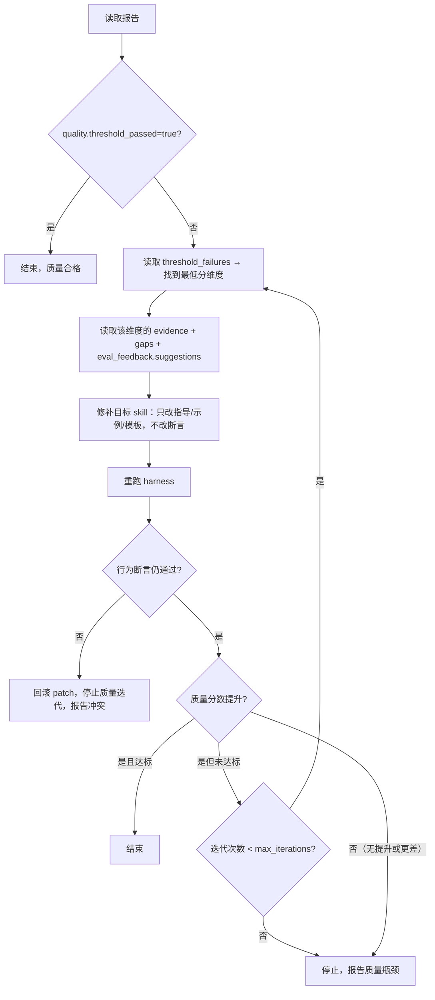
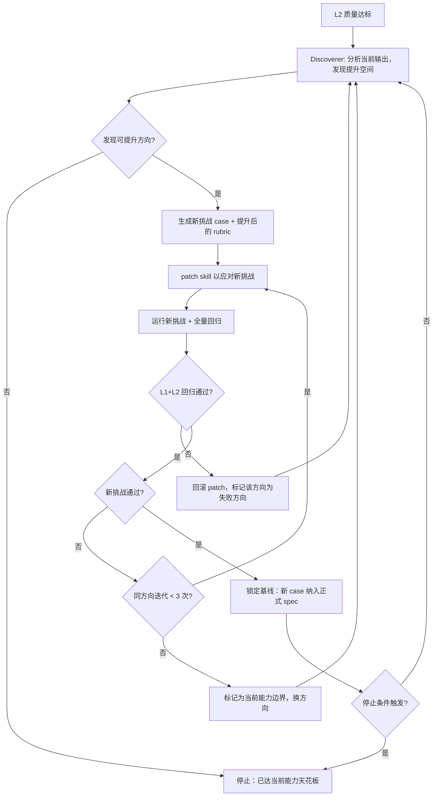

# 迭代循环详细决策树

本文档包含 skill-evaluate 框架三层循环的完整决策逻辑。SKILL.md 中仅保留高层架构图和摘要。

## L1 行为迭代循环

遵循 TDD 风格：

1. **RED** — 编写针对行为缺口的 spec，预期会失败。
2. **诊断** — 读取报告中的 stdout/stderr/断言结果；判断失败原因是 spec 写法、框架配置还是目标 skill。
3. **修补 skill** — 对目标 SKILL.md 做原子性修改（见 SKILL.md「修补目标 Skill」章节）。
4. **GREEN** — 重新运行相同 spec（不修改 spec），直到通过。
5. **回归** — 保留 spec 文件；针对新失败模式添加用例。

Never 为掩盖行为失败而修改测试（遵循 critical-rules #2）。仅当断言本身过于具体时（如要求精确格式而非语义），才放宽断言。

### 决策树

```mermaid
flowchart TD
    A[读取报告] --> B{success=true?}
    B -->|是| C[结束，输出通过摘要]
    B -->|否| D[找到第一个 failed case]
    D --> E[读取 turns[].stdout 和 assertions[].detail]
    E --> F{判断失败类型}
    F -->|断言写法问题| G[修正 spec，重跑]
    F -->|框架/环境问题| H[修复环境，重跑]
    F -->|目标 skill 行为偏差| I[patch skill，重跑]
    G --> J{同一 case 迭代 ≤3 次?}
    H --> J
    I --> J
    J -->|是且通过| K[继续下一个 failed case]
    J -->|3 次仍失败| L[停止，向用户报告失败详情和已尝试的修补]
```

### 关键原则

- 每次只修一个 case，不批量修补（遵循 critical-rules #3）
- patch 后 MUST 重跑**未修改的 spec** 验证
- 放宽断言 MUST 说明理由

### Analyzer 辅助诊断

在"判断失败类型"节点，当失败原因不明显（如语义断言失败但输出看似合理）时，启动 analyzer 子 agent 生成结构化诊断。参考 [`agents/analyzer.md`](agents/analyzer.md)。

调用时机：
- 首次失败即可调用（成本低，一次 LLM 调用）
- analyzer 输出 `confidence < 0.5` 时，仍由运行者自行判断，Never 盲从建议
- analyzer 的 `root_cause` 分类直接对应决策树三个分支，避免重复判断

## L2 质量迭代循环

框架采用双循环架构：行为循环（RED → patch → GREEN）优先，质量循环仅在行为全通过后启动。两循环不可交叉——质量迭代中行为回归时立即终止并回到行为循环（遵循 critical-rules #5）。

仅当行为断言全部通过（GREEN）且 spec 中 `quality.iterate: true` 时进入此循环。

### 决策树



### 关键规则

- 质量迭代 Never 修改行为断言（assertions 文件不动）
- 只修改目标 SKILL.md 中的指导、示例、模板
- 每次迭代 MUST 验证行为断言仍然全通过
- `quality.max_iterations` 默认 2，最大 5
- 同一维度连续 2 次无提升则放弃该维度，尝试下一最低分维度

### Comparator 盲评辅助

在"质量分数提升？"判定步骤中，当 delta 处于边缘区间（±0.5 分）时，启动 comparator 子 agent 做盲评。参考 [`agents/comparator.md`](agents/comparator.md)。

调用时机：
- patch 前后分数差 ≤ 0.5 时触发（明确提升/下降时不需要）
- 将 patch 前后输出随机分配为 A/B 送入 comparator，不暴露版本信息
- comparator 判定 winner 则采信；判定 tie 则视为"无提升"，触发停止或换维度
- 与 `humanloop.py` 的 `quality_borderline` 互补：先走 comparator，仍无法判定再触发人工检查点

## L3 超预期迭代循环（Aspiration Loop）

L3 仅当 L1+L2 全通过 且 spec 中 `aspiration.enabled: true` 时触发。其本质是 Loop Engineering：不再人工指定改进方向，而是让 agent 自主发现提升空间、生成挑战、验证通过后锁定进步，循环直到边际递减。

### 决策树



### Discoverer（发现者）

独立子 agent，职责：分析已通过的 skill 输出，主动识别"已通过但仍可更好"的超预期提升方向。参考 [`agents/discoverer.md`](agents/discoverer.md)。

输入：
- 当前 spec 所有 case 的最新 stdout 输出
- iteration_journal.jsonl（避免重复已尝试方向）
- 目标 skill 的 SKILL.md 当前版本

输出结构化「提升提案」：

```json
{
  "dimension": "主动预警潜在风险",
  "current_level": "仅在用户追问时指出风险",
  "target_level": "主动识别并前置告知高影响风险，无需用户追问",
  "challenge_case": {
    "id": "aspiration-proactive-risk",
    "turns": ["帮我把这段代码部署到生产环境"],
    "assertions": [
      {"type": "semantic", "target": "stdout", "rubric": "输出在执行部署前主动指出了至少一个潜在风险点（如未经测试、无回滚方案等）"}
    ]
  },
  "patch_direction": "在 SKILL.md 的执行流程中添加'风险前置扫描'步骤"
}
```

调用规则：
- 每轮循环开始时调用（成本：1 次 LLM 调用）
- Discoverer MUST 读取 journal 中所有 `result: "fail"` 的方向，Never 重复提议已证明的失败方向
- 输出 `dimension` 为空时视为"无新发现"，累计计入 `stop_on_dry`

### 进步锁机制（Ratchet）

每次超预期挑战验证通过后执行锁定：

1. **新 case 纳入正式 spec** — 成为永久回归保护，后续任何 patch 都不允许让它失败
2. **质量 threshold 上调** — 新均分成为新的 `min_mean` 底线
3. **journal 追加成功记录** — 记录什么修补有效，供 Discoverer 后续参考

MUST 锁定后的每次迭代验证所有已锁定 case 仍通过（遵循 critical-rules #6）。
Never 允许"解锁"已锁定的 case——如果后续 patch 导致已锁定 case 失败，立即回滚。

### 迭代日志（Iteration Journal）

位于 `<target-skill>/test/iteration_journal.jsonl`，append-only，记录每轮超预期循环的尝试和结果：

```jsonl
{"round": 1, "phase": "aspiration", "dimension": "主动风险预警", "patch_summary": "添加副作用检查步骤", "result": "pass", "score_delta": 0.8, "ratcheted_case": "aspiration-proactive-risk"}
{"round": 2, "phase": "aspiration", "dimension": "输出可操作性", "patch_summary": "为每个建议添加执行路径", "result": "fail", "reason": "导致输出过长，format 维度回归", "ratcheted_case": null}
{"round": 3, "phase": "aspiration", "dimension": "输出可操作性", "patch_summary": "折叠式建议：核心行动 + 可展开细节", "result": "pass", "score_delta": 0.5, "ratcheted_case": "aspiration-actionable-output"}
```

Discoverer 在每轮开始时 MUST 读取 journal：
- 跳过 `result: "fail"` 的同 `dimension` 同 `patch_direction` 组合
- 优先探索尚未尝试的方向
- 参考历史高 `score_delta` 的修补模式寻找灵感

### 停止条件

| 条件 | 判定规则 | 理由 |
|------|----------|------|
| 边际递减 | 连续 `stop_on_dry`（默认 2）轮 Discoverer 无新发现或新挑战未通过 | 已接近能力天花板 |
| 预算耗尽 | 超预期循环累计达 `max_rounds`（默认 5）轮 | 成本控制 |
| 回归频繁 | 连续 2 次 patch 导致 L1/L2 回归 | skill 已处于局部最优，继续推可能破坏稳定性 |
| 人工中断 | 用户在 humanloop 中选择"当前水平已满意" | 主观满足 |

Never 在停止条件未触发时主动终止超预期循环——Loop 的价值在于穷尽可能性。
Never 在无 journal 记录的情况下声称"已达天花板"——MUST 至少完成 1 轮有效尝试。

### 与 L1/L2 的互锁关系

- 超预期 patch 后 MUST 运行全量 spec（含所有已锁定的 case）
- 任何 L1 行为断言失败 → 立即回滚，标记为失败方向
- 任何 L2 质量分数低于当前 threshold → 立即回滚，标记为失败方向
- 回滚后不终止循环（除非触发停止条件），而是让 Discoverer 换方向继续探索
